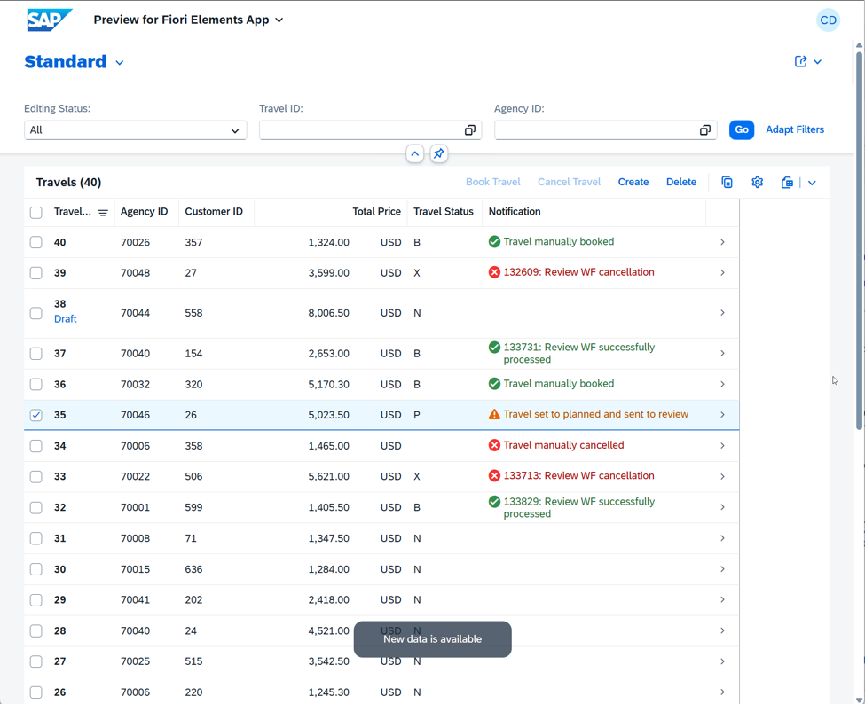
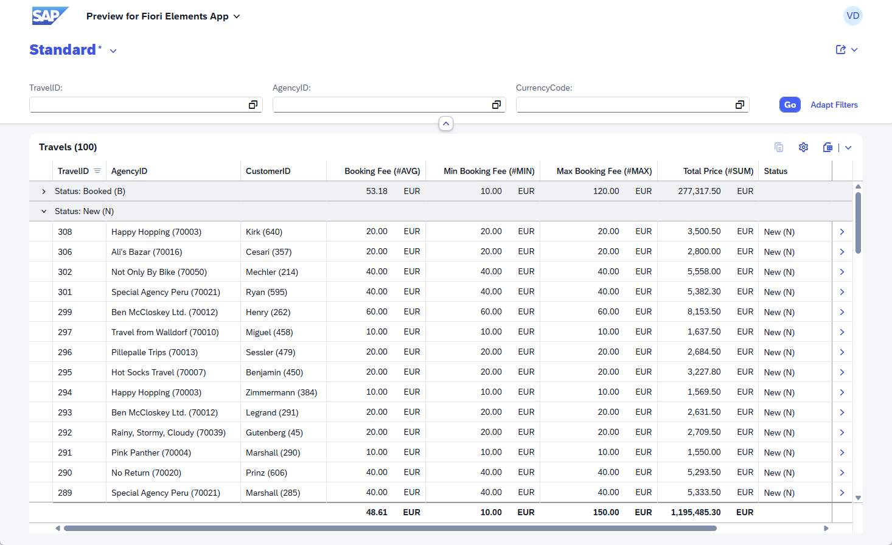
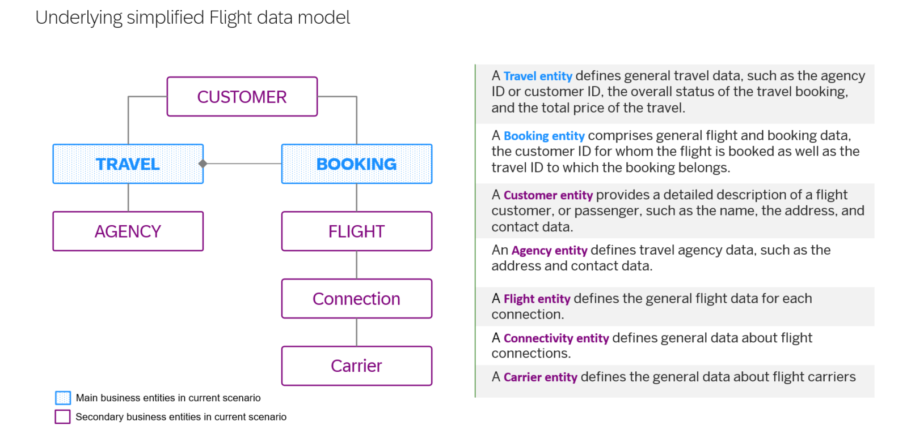

# AD260 - Level up app development with ABAP Cloud innovations and the Joule solution

## Description

This repository contains the material for the SAP TechEd 2026 hands-on workshop **[AD260 (aka RAP201) – Level up SAP Fiori app development with ABAP Cloud innovations and the Joule solution](https://www.sap.com/events/teched/berlin/flow/sap/te26/catalog/page/catalog/session/1786351344862001z6EH)**. 

This hands-on workshop allows developers to explore innovations in the ABAP Cloud development model, especially the ABAP RESTful Application Programming Model, to build modern transactional SAP Fiori apps and services. Generate multi-node business objects and use capabilities like event-driven side effects, collaborative draft, background processing, and analytical tables for a greater end-user experience. Use the SAP Joule for Developers add-on to accelerate your development.

<!--
This hands-on workshop allows developers to explore various ABAP Cloud features, especially within the ABAP RESTful Application Programming Model (RAP), through a guided scenario: 
- ADT wizard "_From Scratch OData UI Service_" to generate an UI service based on a multi-node RAP BO, with SAP Joule forDeveloper from scratch 
- Collaborative draft, enabling multiple users to work on the same RAP business object instance simultaneously
- Event-driven RAP side effects, allowing specific fields to be updated without reloading the entire data whenever a defined business event is raised
- Use of the Background processing framework (bgPF) to asynchronously trigger an external process within a RAP BO
- Read-only RAP Analytical table to provide a data visualization in SAP Fiori, supporting set of structured data and multiple aggregation options
-->

## Level
🧑‍🎓 Intermediate. 

## Table of Contents

<!--
- [Requirements for attending this workshop](#requirements-for-attending-this-workshop) 
--> 

- [Overview](#overview)
- [Exercises](#exercises)
- [Solution Package](#solution-package)
- [Known Issues](#known-issues)
- [How to obtain support](#how-to-obtain-support)
- [Further Information](#further-information)

<!--
## Requirements for attending this workshop
[^Top of page](#)

> To complete the practical exercises in this workshop, you need:
> - An SAP BTP ABAP Environment system (e.g. SAP BTP Trial), **or** access to an SAP S/4HANA Cloud Public Edition system
> - Latest ABAP Development Tools (ADT) Plugin for  Eclipse
> - Basic knowledge of ABAP and the ABAP RESTful Application Programming Model (RAP) - see ([RAP100 – Build Fiori Apps with the ABAP RESTful Application Programming Model](https://github.com/SAP-samples/abap-platform-rap100))

  
🔵 Click to expand!

  The technical requirements to follow the exercises in this repository are:
  1. [Install the latest ABAP Development Tools (ADT) for Eclipse](https://developers.sap.com/tutorials/abap-install-adt.html)
  2. Only for **self-paced mode**:    
     [Create an SAP BTP ABAP Environment Trial User](https://developers.sap.com/tutorials/abap-environment-trial-onboarding.html) or use an on-premise system
     
     >> ⚠ **Regarding SAP-led events or workshops** ⚠️     
     >> → A dedicated system will be provided for SAP-led events.   
     >> → Access details will be shared by the instructors at the beginning of the session.
     

-->

## Overview
[^Top of page](#)

> In this hands-on workshop, you will build and enhance an SAP Fiori elements-based _Travel Processing_ application (_Travel_ app in short) using the ABAP RESTful Application Programming Model (RAP). You will generate a transactional UI service, enhance it with business logic, add collaborative draft handling, implement event-driven side effects, and create a read-only analytical table.

  
🔵 Click to expand!

  In this workshop, you will:
  - Generate a transactional OData-based UI service using Joule and the RAP BO generator
  - Enhance the generated RAP business object with determinations, actions, and dynamic feature control
  - Add collaborative draft handling to the _Travel_ app
  - Implement event-driven side effects
  - Create a read-only RAP Analytical Table for reporting

  The RAP Business Object consists of two entities:
  - **Travel** (root entity)
  - **Booking** (child entity)

🏁 **Resulting apps:** 

  <table border="1">
    <thead>
      <tr>
        <td><b>Exercise blocks A + B</b></td>
        <td><b>Transactional Travel Processing App</b></th>
        <td></th>
      </tr>
    </thead>
    <tbody>
      <tr>
        <td><b>Exercise blocks A + C</b></td>
        <td><b>Read-only Travel Reporting App</b></td>
        <td></td>
      </tr>
    </tbody>
  </table>

 

🗃️ **Underlying simplified Flight data model**

<table border="1">
    <thead>
      <tr>
        <td><b>Underlying simplified Flight data model</b></th>
        <td></th>
      </tr>
    </thead>
  </table>

## Exercises
[^Top of page](#)

Follow the step-by-step instructions provided in the different exercises to build and enhance an application to process  _Travel_ records using the ABAP RESTful Application Programming Model (RAP).

#### Exercise Block A:

This exercise block provides the transactional UI service for the _Travel_ BO for the _Manage Travel_ app, which is further enhanced in the exercise blocks B and C.

| Exercises | -- |
| ------------- | -- |
| [Getting Started](exercises/ex0/README.md) | -- |
| [Exercise 1: Generate your Transactional UI Service with Joule ](exercises/ex01/README.md) | -- |

#### Exercise Block B:

This exercise block enhances the transactional capabilities of the _Manage Travel_ app built in the exercise block A.

 ✅**Prerequisites**: Completion of Exercise Block A

| Exercises | -- |
| ------------- | -- |
| [Exercise 2: Basic Adaptations of the Generated RAP BO](exercises/ex02/README.md) | -- |
| [Exercise 3: Enable the Collaborative Draft Handling](exercises/ex03/README.md) | -- |
| [Exercise 4: Add an Event-Driven RAP Side Effect](exercises/ex04/README.md) | -- |
| [Exercise 5: Use the Background Processing Framework  (bgPF) for Asynchronous Calls](exercises/ex05/README.md) | -- |

#### Exercise Block C:

In this exercise block, you build a new consumption app with basic analytical capabilities for a read-only _Travel Overview_ app, based on the _Travel_ app from exercise block A.

 ✅**Prerequisites**: Completion of Exercise Block A

| Exercises | -- |
| ------------- | -- |
| [Exercise 6: Work with the Read-Only RAP Analytical Table](exercises/ex06/README.md) | -- |

## Solution Package
[^Top of page](#)

You can find the resulting apps in the solution package **`ZRAP201_SOL`** in the dedicated SAP TechEd system.

<!--
> You can import the solution package **`ZRAP201_SOL`** into the following systems:
> - SAP Business AI Platform, ABAP environment
> - SAP S/4HANA Cloud Public Edition

  
🔵 Click to expand!

  Follow the instructions provided below to import the solution:

  1. Open ADT and connect to your ABAP system.
  2. Use the **abapGit** plugin to clone the solution repository.
  3. Follow the on-screen instructions to complete the import.
  

-->

## Known Issues
[^Top of page](#)

No known issues.

## How to obtain support
[^Top of page](#)

[Create an issue](../../issues) in this repository if you find a bug or have questions about the content.

For additional support, [ask a question in SAP Community](https://answers.sap.com/questions/ask.html).

## Further Information
[^Top of page](#)

You can find more information about RAP and related topics here:

- [ABAP RESTful Application Programming Model – Documentation](https://help.sap.com/docs/abap-cloud/abap-rap/abap-restful-application-programming-model)
- [Develop and Run a Fiori Application with SAP Business Application Studio](https://developers.sap.com/mission.sap-fiori-abap-rap100.html)
- [SAP BTP ABAP Environment Community](https://community.sap.com/topics/btp-abap-environment)

## Contributing
If you wish to contribute code, offer fixes or improvements, please send a pull request. Due to legal reasons, contributors will be asked to accept a DCO when they create the first pull request to this project. This happens in an automated fashion during the submission process. SAP uses [the standard DCO text of the Linux Foundation](https://developercertificate.org/).

## License

Copyright (c) 2026 SAP SE or an SAP affiliate company and teched2026-AD260 contributors. All rights reserved. This project is licensed under the Apache Software License, version 2.0 except as noted otherwise in the [LICENSE](LICENSES/Apache-2.0.txt) file; you may not use any file of this project except in compliance with the License.

Unless required by applicable law or agreed to in writing, software distributed under the License is distributed on an "AS IS" BASIS, WITHOUT WARRANTIES OR CONDITIONS OF ANY KIND, either express or implied. See the LICENSE for the specific language governing permissions and limitations under the License.
