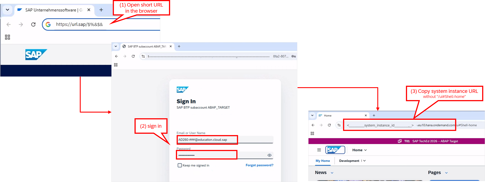
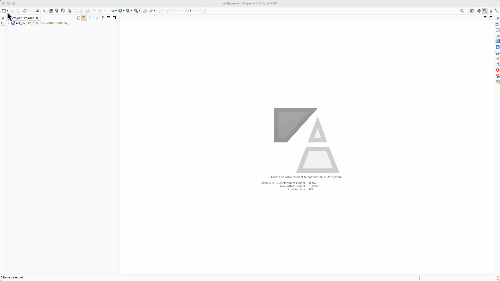
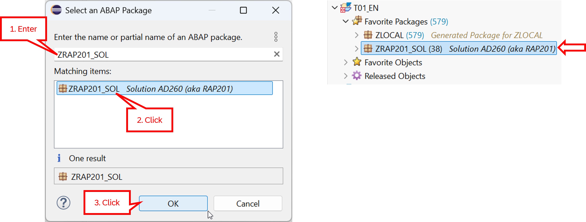
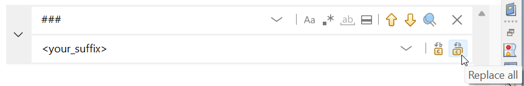

[Home - AD260](../../README.md)

# Getting Started

## Introduction

In this exercise, you will choose a unique suffix for your development objects and verify if your development environment is ready.

## Exercises

- [0.1 - Identify Your Personal Suffix](#exercise-01-identify-your-personal-suffix)
- [0.2 - Create an _ABAP Cloud Project_ in ADT](#exercise-02-create-an-abap-cloud-project-in-adt)
- [0.3 - Solution Package](#exercise-03-solution-package)
- [0.4 - Useful information](#exercise-04-useful-information)
- [Summary & Next Exercise](#summary--next-exercise)

> [!NOTE]
> **Reminder**: Remember to replace all occurrences of the placeholder **`###`** with your personal suffix in all exercise steps.

---

## Exercise 0.1: Identify Your Personal Suffix

> Discover your personal unique suffix `###` that you will use throughout all exercises to make your development objects unique.
> 
> At the **SAP TechEd Berlin**, you will use your seat number as suffix if no other suffix has been assigned to you by the 🗣️speaker team.

  
Click to expand!

   
1. Throughout the exercises of this hands-on workshop, you'll be requested to replace the placeholder **`###`** with your personal unique suffix.

   This is required to make your development objects unique, as all participants are working in the same system **T01**.
 
   At **SAP TechEd Berlin**, you will use the unique suffix assigned to you by the instructor (see handout) – which is your seat number **`###`**.  

   For example, for the first seat with the seat number  **`Session A: 001`** / **`Session B: 041`**:   
  
   | Session | Seat number | Personal Suffix |
   |-- | -- | -- |
   | A | 001 | **`001`** |
   | B | 041 | **`041`** |

3. 💡 Write down your personal suffix so you don't forget it.

## Exercise 0.2: Create an _ABAP Cloud Project_ in ADT

> Create an _**ABAP Cloud Project**_ in your ADT installation to connect it to the provided **SAP Business AI Platform, ABAP environment** system.

  
Click to expand!

   
   
1.Open the ABAP Development Tools (ADT) for Eclipse and open the **ABAP** perspective if not yet open.

   

2. **Resolve the short URL** provided by the instructor team in the handout as follows: 

    - Start the browser by double-clicking the icon on the desktop.
    - Type the short link from the handout into the address bar of your browser and press **Enter**.
      
      >> ℹ️ If the **Welcome to ABAP_TARGET!** page appears:
      >>  
      >> Click the **`tdct3----.accounts.ondemand.com`** link in the browser to continue.  
      
    - Enter the user credentials provided in the handout and press **Confirm** to sign in.   

      | Property | Value |
      | -- | -- |
      | E-Mail or User Name: | **AD260-###@education.cloud.sap** (where `###` is your personal suffix)  |
      | Password: | _provided in the handout or by the speaker team_ |
          
      The **Fiori Launchpad** of the SAP BAIP, ABAP environment is now opened.

    - Now, copy the ABAP system URL from the address bar to the clipboard.  
    
      You will use it in the next step to create your ABAP Cloud project in ADT.
    
      >> ℹ️ Copy the URL without the `/ui#Shell-home` part at the end!
      >> 
      >> ABAP Service Instance URL: `https://<instance_number>.abap.<region>.hana.ondemand.com`

   

2. Now, create an _**ABAP Cloud Project**_ to connect to the ABAP environment. 

   Enter the **ABAP Service instances URL** from the previous step and click on **Next**.
   
   Click on **Open Logon in Browser** in the following dialog to open the Sign-In page in the browser.

   Proceed with the following steps if you're not logged in automatically:

   >> ℹ️ If the **Welcome to ABAP_TARGET!** page appears:   
   >> Click the `tdct3----.accounts.ondemand.com` link in the browser to continue.  

   - Sign in with the user credentials provided in the handout:
   
     | Property | Value |
     | -- | -- |
     | E-Mail or User Name: | **AD260-###@education.cloud.sap** (where `###` is your personal suffix) |
     | Password: | _provided in the handout or by the speaker team_ |

   - After the successful sign in in the browser, go back to ADT and press **Finish**.

   <!--  -->

## Exercise 0.3: Solution Package

> Participants of SAP-led events, such as on-site SAP TechEd 2026 events, will find the solution package `ZRAP201_SOL` in the dedicated ABAP system provided by SAP.

  
🔵 Click to expand!

1. You can add the solution package **`ZRAP201_SOL`** as favorite package in the **Project Explorer**. 

   To achieve that,
   - right-click on the **Favorite Packages**,
   - select **Add Package...** from the context menu,
   - then enter the name of the package in the dialog: **`ZRAP201_SOL`**,
   - select the entry, and press **OK** to confirm.
     
    
    

2. Optional: You can remove the **`ZLOCAL`** package from your favorites by right-clicking it and selecting **Remove from Favorite Packages** from the context menu. 

## Exercise 0.4: Useful information 
   
> This section contains some useful information for the exercises: Find and replace, modern ABAP syntax, and useful ADT shortcuts.

  
Click to expand!

 
### Find/Replace

In the course of these exercises you will frequently see the task to "_replace the placeholder **`###`** with your personal suffix_". 

To achieve that, it's recommended to make use of the **Find/Replace** function (**Ctrl+F**) in the Eclipse editors.
   
    
  
### Modern ABAP Syntax

The modern, declarative, and expression-oriented ABAP language syntax will be used in the different exercises. It allows developers to write more simple and concise source code using new language features like inline declarations, constructor expressions.

> 💡 Find more information in the ABAP Keyword Documentation: [ABAP - Programming Language](https://help.sap.com/doc/abapdocu_cp_index_htm/CLOUD/en-US/index.htm?file=abenabap_reference.htm) 

  
### Useful ADT for Eclipse Shortcuts

> 💡 You can display the full list of available shortcuts in the **Show Key Assit** in ADT by pressing **Ctrl+Shift+L**.
   
Here are some of the most used keyboard shortcuts for the ABAP development tools for Eclipse.
   
 

More useful ADT shortcuts can be found on the SAP Help Portal here: [Link](https://help.sap.com/docs/abap-cloud/abap-development-tools-user-guide/keyboard-shortcuts-for-abap-development).

## Summary & Next Exercise
[^Top of page](#introduction)

Now that you've...
- identified your unique suffix **`###`** and
- connected ADT to the ABAP environment, 

you can continue with the next exercise – **[Exercise 1: Generate your transactional UI service with Joule](../ex01/README.md)**

---
