[Home - AD260](../../README.md)

# Exercise 1: Generate your Transactional UI Service with Joule

## Introduction

In the previous exercise, you've specified your unique suffix `###` and verified your development environment (_see [Getting Started](../ex0/README.md)_).

In this exercise, you will create your exercise package `ZRAP201_###` to group all the artifacts that you will create in the exercises and generate the transactional OData-based UI service for the Fiori elements-based _Manage Travel_ app (henceforth _Travel_ app) using the _OData UI Service From Scratch_ wizard and the SAP Joule for Developers, ABAP AI capabilities, aka Joule. 

The _Travel_ app will be based on a multi-node _Travel_ BO with two entities _Travel_ (root) and _Booking_.

## Exercises

- [1.1 - Create your Exercise Package](#exercise-11-create-your-exercise-package)
- [1.2 - Generate your Transactional UI Service with Joule](#exercise-12-generate-your-transactional-ui-service-with-joule)
- [1.3 - Publish and Preview the _Travel_ App](#exercise-13-publish-and-preview-the-travel-app)
- [1.4 - Create a Helper Interface](#exercise-14-create-an-helper-interface)
- [1.5 - Generate Demo Data](#exercise-15-generate-demo-data)
- [Summary & Next Exercise](#summary--next-exercise)

> [!TIP]
> 
> <details>
>  <summary>Click to expand!</summary>  
>  
> - Always replace all occurrences of the placeholder **`###`** in the provided code snippets with your personal suffix.
> - Use the ADT function _**Find and Replace All**_ (**Ctrl+F**) to quickly replace text in the source code.
> - Use the ADT function _**Quick Fix**_ (**Ctrl+1**), aka _Quick Assist_, on an erroneous element to get help with resolving the issue.
> - Use the **Show ABAP element info** view (**F2**) to inspect an element in ADT editors.
> - Use the **ABAP Formatter** function (**Ctrl+F1**) to format your source code.
>   
> > You may need to configure the _ABAP Formatter_ and the _DDL Formatter_ if you are using it for the first time in a given system under the Eclipse menu **Window > Preferences** and navigate to **ABAP Development > Source Code Editor** to configure the _**ABAP Formatter**_ and then go to **> CDS > DDL Formatter**. You can search for _"Formatter"_.
> - [Useful Keyboard Shortcuts for ABAP Development](https://help.sap.com/docs/ABAP_PLATFORM_NEW/c238d694b825421f940829321ffa326a/4ec299d16e391014adc9fffe4e204223.html?version=latest) (ADT shortcuts)
> 
> </details>

> [!NOTE]
> **About the ABAP Cloud Generators in ADT: _Generate ABAP Repository Objects_ Wizards**
> 
> <details>
>  <summary>Click to expand!</summary>  
>
>  <br/>
>   
>  The ABAP development tools for Eclipse (ADT) offers developers different wizards that support you in generating repository objects required for use cases like creating a transactional app, or creating integration services. Depending on the wizard you choose, you start the generation process with an already existing repository object, or completely from scratch. You can also decide whether your business object (BO) should be generated as a UI service or a Web API service.   
>  
> The **_OData UI Service from Scratch_ wizard** allows developers to generate all RAP service-related repository objects from scratch by using the OData UI Service from Scratch wizard. You don't need an already
>  existing repository object, because you can start the wizard from an empty package. The wizard allows developers to create a RAP business object by either using the wizard manually or with the aid of the Joule chat.
>  The created BOs can have one or multiple node entities.  
>  
> **Learn more:** [Generating a RAP Business Service with the _Generate ABAP Repository Objects_ Wizards](https://help.sap.com/docs/abap-cloud/abap-rap/generating-rap-business-service-with-generate-abap-repository-objects-wizard) | [Using the OData UI Service from Scratch Wizard](https://help.sap.com/docs/abap-cloud/abap-rap/using-odata-ui-service-from-scratch-wizard)
>  </details>

---

## Exercise 1.1: Create your Exercise Package

> Create your exercise package `ZRAP201_###` to group all development artifacts that you will create in this hands-on workshop.

<details>
  <summary>🔵 Click to expand!</summary>

1. In ADT, 
   - go to the **Project Explorer**,
   - right-click on the **`ZLOCAL`**,
   - and select **New** > **ABAP Package** from the context menu. 

2. Enter the following values:

   | Field | Value |
   |---|---|
   | Package Name | **`ZRAP201_###`** |
   | Description | **`RAP201: Exercise Package (###)`** |
   | Add to favorite packages | `☑️` Select the box  |
   | Superpackage | **`ZLOCAL`** |

3. Then, 
   - Click **Next >**,   
   - select a transport request if required,    
   - then click **Finish** to confirm the creation.
     
</details>

## Exercise 1.2: Generate your Transactional UI Service with Joule

> Generate an OData UI service using the ABAP Cloud Generator: Transactional app from scratch
> 
> Create a transactional OData-based UI service based on a RAP BO with two child node entities, _Travel_ (root entity) and _Booking_, using the ABAP Cloud generator **OData UI Service from Scratch** and the SAP Joule for Developers, ABAP AI capabilities.
>

<!--
> [!IMPORTANT]
> The names of the development artifacts, table fields, and other elements in your package may differ from those shown in this tutorial, as they are generated by GenAI and are therefore not fully deterministic.
>
> To achieve a certain level of consistency, we will provide as much information as possible in the prompts to ensure consistent field names. This is crucial for the straightforward reuse of the code snippets provided throughout the different exercises.
> 
-->

<details>
  <summary>🔵 Click to expand!</summary>

1. In ADT, 
   - right-click on your exercise package **`ZRAP201_###`**,
   - select  **Generate ABAP Repository Objects...** from the context menu,
   - choose **OData UI Service from Scratch**,
   - and click **Next**.

     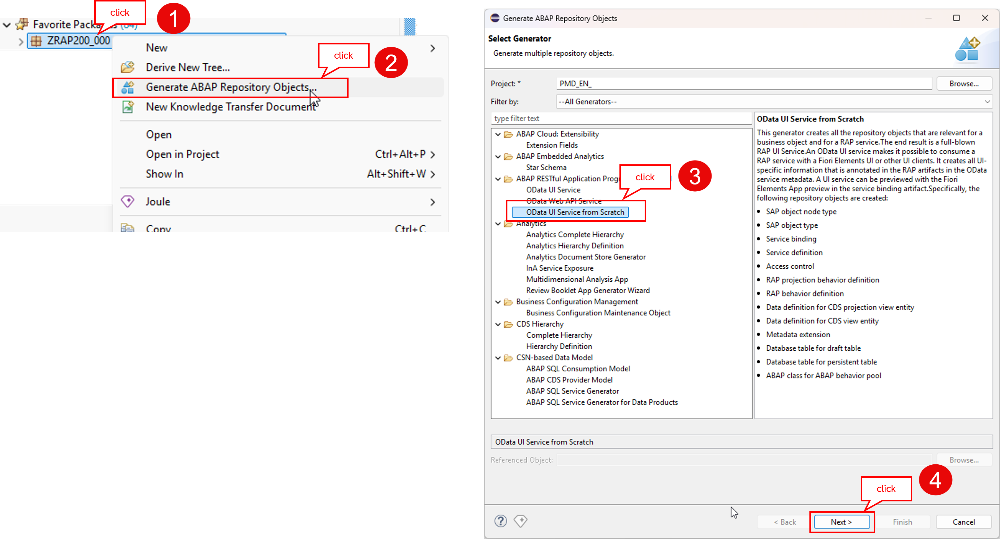 

   - Make sure that your package is maintained on the next wizard dialog, then 
   - click **Next >**, and proceed with the configuration of the _Travel_ BO. 

2. Then, 
   - Copy and paste the prompt provided below in the 💎**Joule** chat on the right-hand side,
   - replace **`###`** with your personal suffix, and 
   - press **Enter** to send the message.

     > 💡**Hint:**   
     > The names of the development artifacts, table fields, and other elements in your package may differ from those shown in this tutorial, as they are generated by GenAI and are therefore not fully deterministic.
     > To achieve a certain level of consistency, we have provided as much information as possible in the prompt to ensure consistent field names. This is crucial for the straightforward reuse of the code snippets provided
     > throughout the different exercises of this hands-on workshop.
     > 
     > We named the entities **`TravelTP`** and **`BookingTP`** to avoid name collision with other sessions working with the same BO entities.

     ℹ️ Do not forget to replace **`###`** with your personal suffix.

      ```
       Create a transactional travel management application with draft. Use suffix "###".
      
       Define a main entity called "TravelTP" with the following fields:
      
       travel_id: abap.numc(8), semantic ID
       agency_id: abap.numc(6)
       customer_id: abap.numc(6)
       begin_date: semantic type DATE
       end_date: semantic type DATE
       booking_fee: abap.curr(16,2), using currency_code as currency reference
       total_price: abap.curr(16,2), using currency_code as currency reference
       currency_code: abap.cuky(5)
       description: abap.sstring(1024)
       status: abap.char(1)
       review_status: Data Element INT1
       notification: abap.char(60)
      
       Add a child entity called "BookingTP" with the following fields:
      
       booking_id: abap.numc(4), semantic ID
       booking_date: semantic type DATE
       customer_id: abap.numc(6)
       carrier_id: abap.char(3)
       connection_id: abap.numc(4)
       flight_date: semantic type DATE
       flight_price: abap.curr(16,2), using currency_code as currency reference
       currency_code: abap.cuky(5)   
      ```

3. After a few seconds, 
   - review Joule's proposal in the chat,
   - press **Accept** to confirm it and update the configuration of the service artifacts, and
   - select **☑️ Use CDS Table Entities** in the **Service configuration** tab (under the _Service Type_).      

     | (1) Accept Joule's proposal | (2) Review the updated content |
     |---|---|   
     | 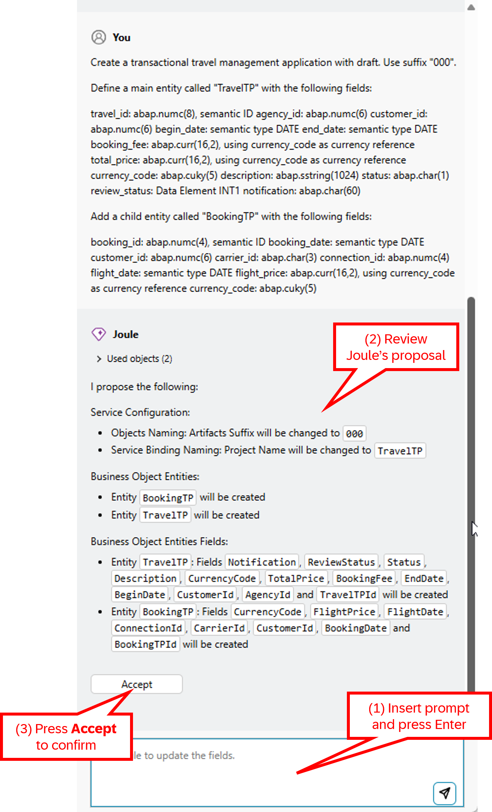   | 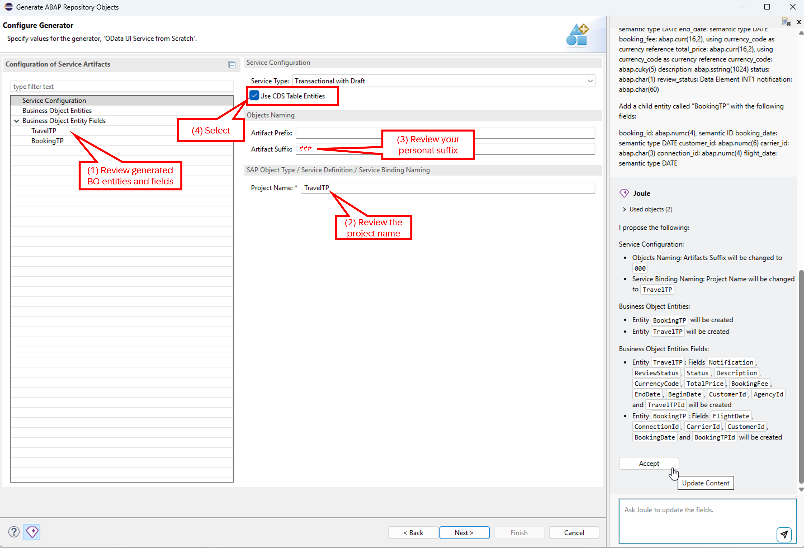   |
   
4. Review the definition of the **TravelTP** root entity and the **BookingTP** child entity under the **Business Object Entity Fields** tab on the right-hand side.

   > ℹ️ **Info:**   
   > Most of the time, Joule names semantic keys according to the related business entities. For example, in the present case:
   > - **`TravelTPId`** has probably been proposed as the semantic key for the **TravelTP** entity
   > - **`BookingTPId`** has probably been proposed as the semantic key for the **BookingTP** entity
   >   
   > While this is generally correct, according to the naming convention used in this exercise, the semantic keys should be named **`TravelId`** and **`BookingId`**. 
   > This means we will likely need to rename these fields in the next step.

   | Entity name | Fields definition |
   |---|---|
   | **TravelTP** | 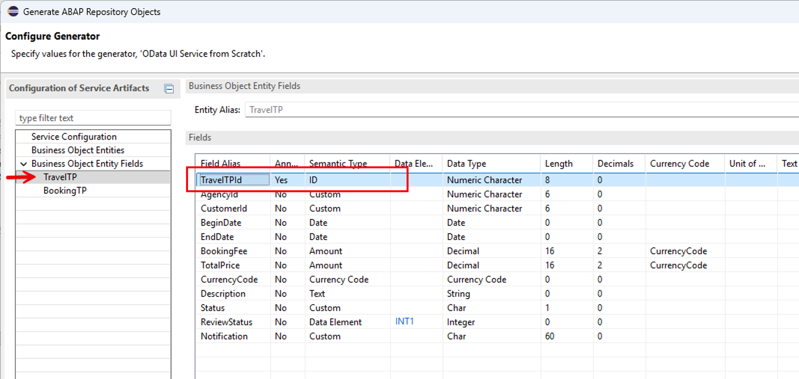  |
   | **BookingTP** | 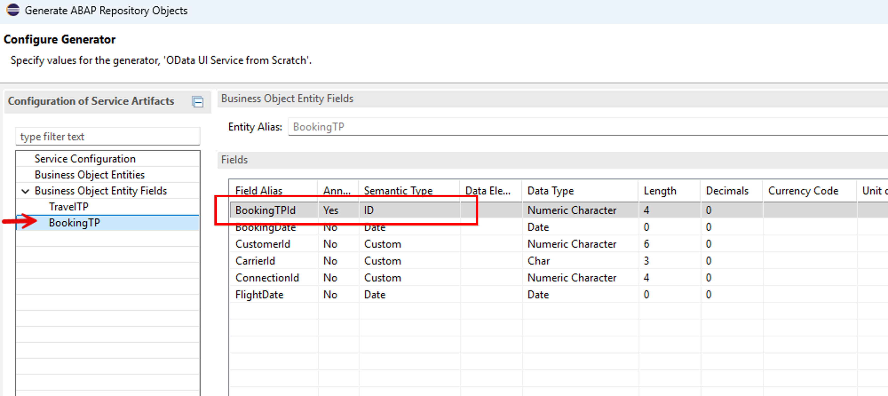  |

5. Rename the semantic key fields of the travel and booking entities **`TravelId`** and **`BookingId`**, respectively, if they are named otherwise.

   To achieve that, 
   - Go to **Business Object Entity Fields** in the wizard, 
   - check out the name of the semantic keys of the travel and the booking entities, and
   - Use **option 1** (manually) or **option 2** 💎(Joule) below to rename the fields.

     - **Option 1**: Rename the fields manually using the **Edit** button on the right-hand side.
     
         - For the **TravelTP** entity: Rename **`TravelTPId`** to **`TravelId`**
         - For the **Booking** entity: Rename **`BookingTPId`** to **`BookingId`**

     - **Option 2**: Renaming fields with 💎**Joule** by copying and pasting the prompt below into the chat and pressing **Enter**. Then review Joule's proposal and press **Accept** to update the service configuration.
     
       ```
       Rename "TravelTPId" to TravelId in the "TravelTP" entity.
       Rename "BookingTPId" to BookingId in the "BookingTP" entity.
       ```
              
     The field names should now be updated to **`TravelId`** and **`BookingId`**.

     | TravelTP | BookingTP |
     |---|---|   
     | 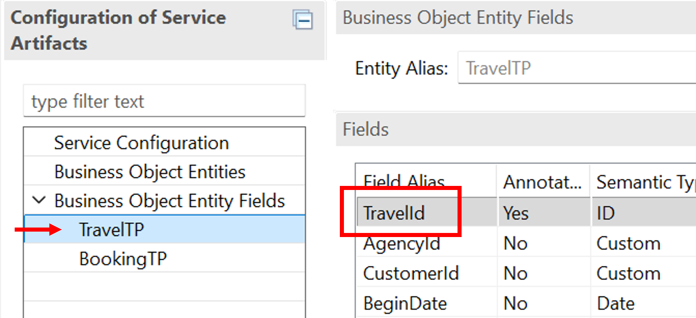  | 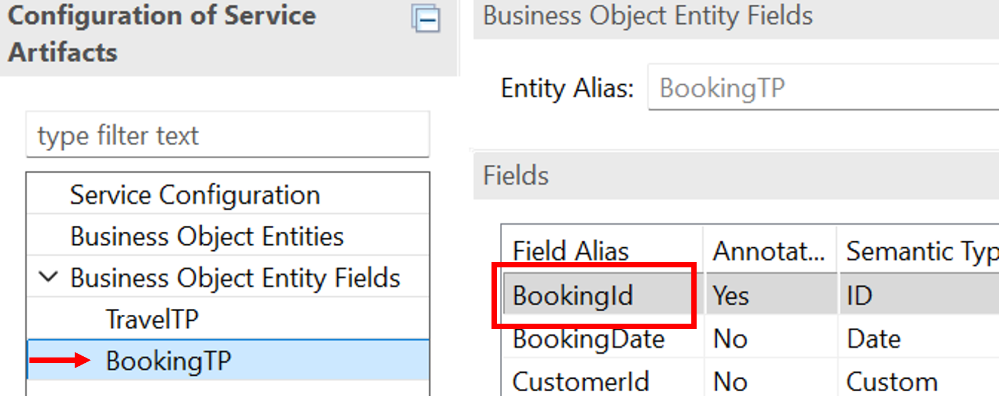  |
   
6. Now, review and adjust the updated content under **Service Configuration**.
     
     - Make sure your personal suffix **`###`** is specified under **Artifact Suffix**.

     - Make sure **☑️ Use of CDS Table Entities** is selected.
          
       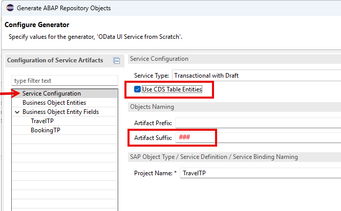 
   
7. Click **Next >** and review the development artifacts that will be generated - see screenshots below. 

   If the **Data Base Model Layer** with dictionary tables underneath is displayed, then  
   - go back to the previous step, and 
   - select **☑️ Use of CDS Table Entities**.

     > 💡**Hint:** No dictionary tables will be listed among the artifacts to be generated, as CDS table entities are used for data persistence.

     | ✅ CORRECT | ❌ WRONG |
     |---|---|   
     | 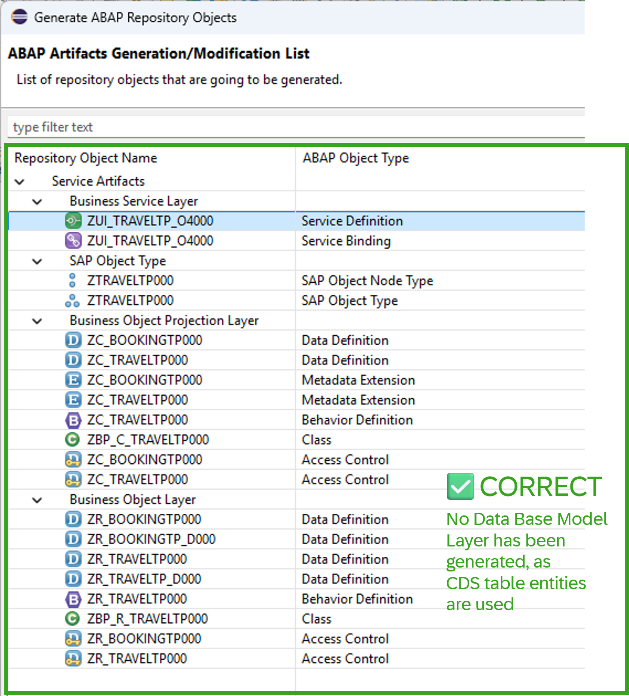  | 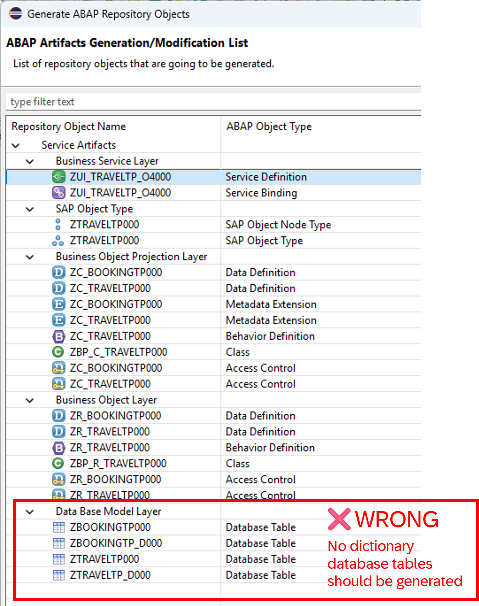  |   

8. Then, 
   - click **Next >**,
   - create or choose a transport request if required,
   - click **Next >**, and
   - confirm with **Finish** to generate all artifacts.

     > 💡 The generation may take a moment. You can check the generation status in the workbench status line at the bottom of the ADT window.
   
   - After a few moments, the **Generate ABAP Repository Objects** dialog will appear to inform you about the successful generation. 

   - Click **Open** to open the generated service binding **`ZUI_TRAVELTP_O4###`**.
  
9. Refresh (**F5**) your exercise package in the **Project Explorer** to load all generated development objects if not yet displayed after the successful generation. 

   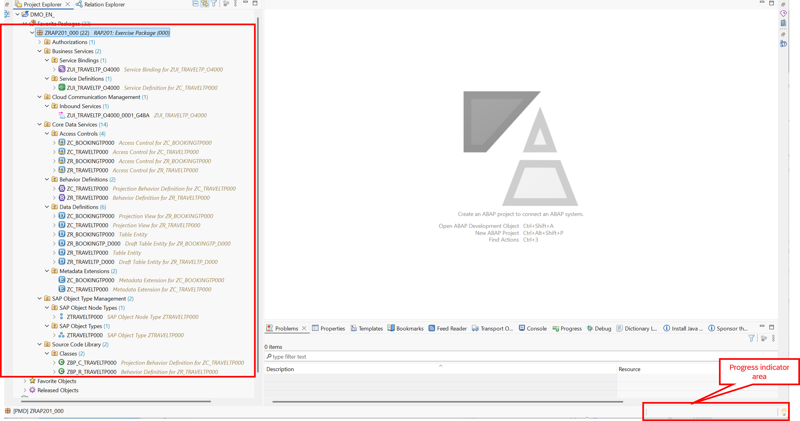 

   <!--  -->
   <!-- TODO: Provide an animated Gif of the entire step 1.2 -->   

<br/>

</details>


## Exercise 1.3: Publish and Preview the _Travel_ App

> Publish the service endpoint of your service binding `ZUI_TRAVELTP_O4###` and preview the generated Fiori Elements app.

<details>
  <summary>🔵 Click to expand!</summary>

1. To achieve that,
   - Go to the **Project Explorer**,
   - open the service binding **`ZUI_TRAVEL_O4###`**, then
   - click the **Publish** button to publish the local service endpoint. 

   This will take a few seconds. As indicated in the editor, **do not** modify, close or refresh the service binding while publishing is in progress.

   <!--  -->
   
2. Now, 
   - go to the **Service Version Details** area,
   - select the leading **`TravelTP`** entity, and
   - start the **Fiori Elements App Preview** by pressing the **Preview...** button or double-clicking it.  

   The _Travel_ app will be started in the browser.

3. Press **Go** to load the data in the app and test the app. 

   The list should be **empty** at this point since no demo data has been generated yet.
       
   You will enhance the business logic and improve the UI of the generated _Travel_ app in the next exercise.
   
   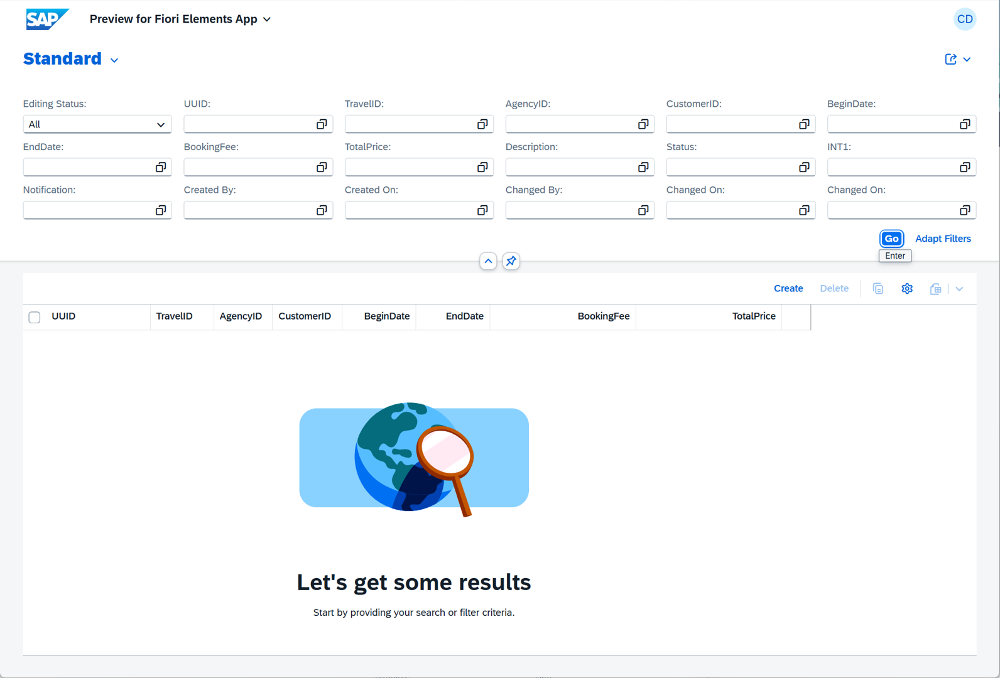 

</details>


## Exercise 1.4: Create a Helper Interface 

> Create the interface `ZRAP201_IF_TRAVEL###` as helper interface to provide reuse constants and functionalities centrally.

<details>
  <summary>🔵 Click to expand!</summary>
  
1. In ADT, 
   - right-click on your package **`ZRAP201_###`**, and
   - select **New** > **ABAP Interface**.

2. Enter the following values:

   | Field | Value |
   |---|---|
   | Name | **`ZRAP201_IF_TRAVELTP###`** |
   | Description | **`Constants and other stuff`** |

3. Now, 
   - Replace the interface skeleton with the 📄source code provided below, and
   - use **Ctrl+F** to replace all occurrences of the placeholder **`###`** with your personal suffix.

   <details>
     <summary>🟡📄 Click to expand the source code!</summary>

   ```abap
   INTERFACE zrap201_if_traveltp###
     PUBLIC .
     CONSTANTS:
       BEGIN OF travel_status,       "/dmo/travel_status
         new       TYPE c LENGTH 1 VALUE 'N', "New       | 0
         booked    TYPE c LENGTH 1 VALUE 'B', "Booked    | 1
         planned   TYPE c LENGTH 1 VALUE 'P', "Planned   | 2
         cancelled TYPE c LENGTH 1 VALUE 'X', "Cancelled | 3
       END OF travel_status,
    
       BEGIN OF review_status,
         new       TYPE int1 VALUE 0, "(N) New
         cancelled TYPE int1 VALUE 1, "(C) cancelled
         planned   TYPE int1 VALUE 2, "(P) planned
         booked    TYPE int1 VALUE 3, "(B) booked
       END OF review_status,
    
       BEGIN OF review_notification,
         new       TYPE string VALUE ' ',                                              "(N)New       | 0: neutral
         cancelled TYPE string VALUE 'Travel cancellation by review WF for',           "(X)cancelled | 3: red
         planned   TYPE string VALUE 'Travel set to planned and sent to review WF...', "(P) planned  | 2: yellow
         booked    TYPE string VALUE 'Travel successfully booked by review WF',        "(B) booked   | 1: green
       END OF review_notification.
    
   ENDINTERFACE. 
   ``` 

   </details>

4. Save  (**Ctrl+S**) and activate  (**Ctrl+F3**) the changes.

</details>


## Exercise 1.5: Generate Demo Data

> Create and execute the class `ZRAP201_GENERATE_DEMO_DATA_###` to generate demo data for the Travel and Booking entities.

<details>
  <summary>🔵 Click to expand!</summary>

1. To achieve that, 
   - right-click on your package **`ZRAP201_###`**, and
   - select **New** > **ABAP Class**.

2. Enter the following values:

   | Field | Value |
   |---|---|
   | Name | **`ZRAP201_GENERATE_DEMO_DATA_###`** |
   | Description | **`Generate demo data for travels and bookings`** |

3. Now, 
   - replace the complete class definition with the 📄source code provided below, and
   - replace all occurrences of the placeholder **`###`** with your personal suffix using **Ctrl+F**.

   <details>
     <summary>🟡📄 Click to expand the source code!</summary>

     > 💡**Hints**:  
     > - Replace all occurrences of the placeholder **`###`** with your personal suffix using _**Find and Replace All**_ function (**Ctrl+F**)  
     > - Use the **ABAP Formatter** function (**Ctrl+F1**) to format your source code
     >   > You may need to configure the _ABAP Formatter_ and the _DDL Formatter_ if using it for the first time in a given system under the Eclipse menu **Window > Preferences**
     >   > and navigate to **ABAP Development > Source Code Editor** to configure the _**ABAP Formatter**_.
     >    
  
   ```abap  
   CLASS zrap201_generate_demo_data_### DEFINITION
     PUBLIC
     FINAL
     CREATE PUBLIC .
     PUBLIC SECTION.
       INTERFACES if_oo_adt_classrun.
  
     PROTECTED SECTION.
     PRIVATE SECTION.
   ENDCLASS.
  
   CLASS zrap201_generate_demo_data_### IMPLEMENTATION.
  
     METHOD if_oo_adt_classrun~main.
       DATA travel_data  TYPE TABLE OF zr_travelTP###.
       DATA booking_data TYPE TABLE OF zr_bookingTP###.
  
       " delete existing entries in the active database tables
       DELETE FROM zr_travelTP###.
       DELETE FROM zr_bookingTP###.
  
       " delete existing entries in the draft database tables
       DELETE FROM zr_traveltp_d###.
       DELETE FROM zr_bookingtp_d###.
  
       COMMIT WORK.
  
       " copy the first 100 travels from the classic table /DMO/TRAVEL
       " (this table has no UUID key, so a fresh UUID is generated below;
       "  source field names differ from the target, so they are aliased explicitly)
       SELECT FROM /dmo/travel
         FIELDS travel_id     AS travelid,
                agency_id     AS agencyid,
                customer_id   AS customerid,
                begin_date    AS begindate,
                end_date      AS enddate,
                booking_fee   AS bookingfee,
                total_price   AS totalprice,
                currency_code AS currencycode,
                description   AS description,
                status        AS status,
                createdby     AS localcreatedby,
                createdat     AS localcreatedat,
                lastchangedby AS locallastchangedby,
                lastchangedat AS locallastchangedat,
                lastchangedat AS lastchangedat
         WHERE currency_code = 'EUR'
         INTO CORRESPONDING FIELDS OF TABLE @travel_data
         UP TO 100 ROWS.
  
       " generate the UUID keys and derive review status / notification
       " (/DMO/TRAVEL uses the classic status handling: N / B / P / X)
       TRY.
           LOOP AT travel_data ASSIGNING FIELD-SYMBOL(<ls_travel>).
             " generate a fresh UUID key for the target table entity
             <ls_travel>-uuid = cl_system_uuid=>create_uuid_x16_static( ).
  
             CASE <ls_travel>-status.
               WHEN zrap201_if_travelTP###=>travel_status-booked. "'B'
                 <ls_travel>-reviewstatus = zrap201_if_travelTP###=>review_status-booked.
                 <ls_travel>-notification = 'Travel manually booked'.
               WHEN zrap201_if_travelTP###=>travel_status-planned. "'P'
                 <ls_travel>-status = zrap201_if_travelTP###=>travel_status-new. "'N'.
               WHEN zrap201_if_travelTP###=>travel_status-cancelled. "'X'
                 <ls_travel>-reviewstatus = zrap201_if_travelTP###=>review_status-cancelled.
                 <ls_travel>-notification = 'Travel manually cancelled'.
               WHEN OTHERS.                                              
                 <ls_travel>-reviewstatus = zrap201_if_travelTP###=>review_status-new. "'N' 
                 CLEAR <ls_travel>-notification.
             ENDCASE.
           ENDLOOP.
         CATCH cx_uuid_error INTO DATA(travel_uuid_error).
           out->write( |❌ Error generating travel UUID: { travel_uuid_error->get_text( ) }| ).
           RETURN.
       ENDTRY.
  
       " insert travel demo data
       MODIFY zr_travelTP### FROM TABLE @travel_data.
       COMMIT WORK.
  
       " copy the bookings that belong to the copied travels from the classic table /DMO/BOOKING.
       " The join against the freshly inserted zR_travelTP### does two things at once:
       "  - it restricts the bookings to the 100 copied travels, and
       "  - it provides each booking's parent UUID (the generated travel UUID) directly.
       SELECT FROM /dmo/booking AS booking
                INNER JOIN zr_travelTP### AS !travel ON booking~travel_id = travel~travelid
         FIELDS travel~uuid           AS parentuuid,
                booking~booking_id    AS bookingid,
                booking~booking_date  AS bookingdate,
                booking~customer_id   AS customerid,
                booking~carrier_id    AS carrierid,
                booking~connection_id AS connectionid,
                booking~flight_date   AS flightdate,
                booking~flight_price  AS flightprice,
                booking~currency_code AS currencycode
         WHERE currency_code = 'EUR'
         INTO CORRESPONDING FIELDS OF TABLE @booking_data.
  
       " generate a fresh UUID key for each target booking entity
       " (/DMO/BOOKING has no UUID key; the parent link is already set via ParentUUID)
       TRY.
           LOOP AT booking_data ASSIGNING FIELD-SYMBOL(<ls_booking>).
             <ls_booking>-uuid = cl_system_uuid=>create_uuid_x16_static( ).
           ENDLOOP.
         CATCH cx_uuid_error INTO DATA(booking_uuid_error).
           out->write( |❌ Error generating booking UUID: { booking_uuid_error->get_text( ) }| ).
           RETURN.
       ENDTRY.
  
       " insert booking demo data
       MODIFY zr_bookingTP### FROM TABLE @booking_data.
       COMMIT WORK.
  
       out->write(
           | ✅ [RAP201 (system time:{ cl_abap_context_info=>get_system_time( ) })] Travel and booking demo data successfully inserted.| ).
  
     ENDMETHOD.
  
   ENDCLASS.   
   ```
   
   </details>
     
4. Save  (**Ctrl+S**) and activate  (**Ctrl+F3**) the changes.

5. Execute the class as **Console App** by pressing **F9**.

   <!--   -->

6. Refresh your app in the browser and press **Go** to load the generated data.

   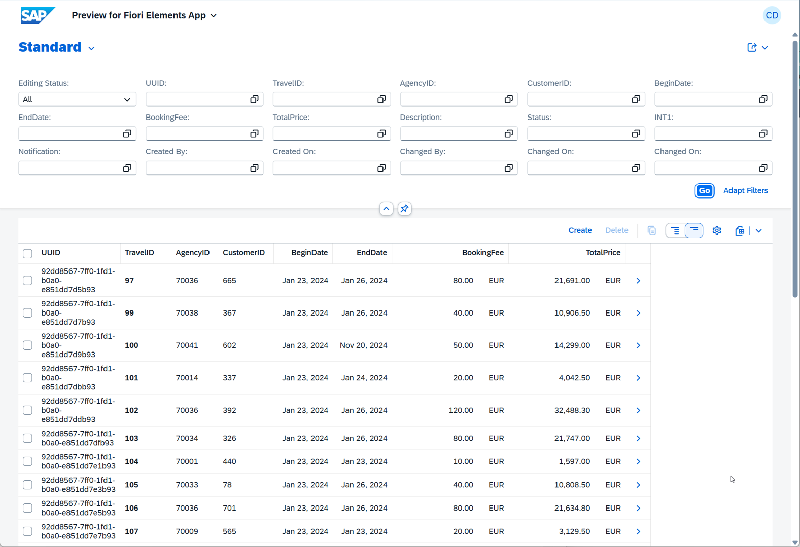 

</details>

## Summary & Next Exercise
[^Top of page](#introduction)

Now that you've...
- generated a transactional UI service with two BO entities (Travel and Booking) using the RAP generator `OData UI Service from Scratch` and 💎Joule,
- published the service endpoint and previewed the Fiori elements app, and
- generated demo data for the _Travel_ and _Booking_ entities,

you can continue with the next exercise – **[Exercise 2: Basic Adaptations of the Generated UI Service](../ex02/README.md)**

---
