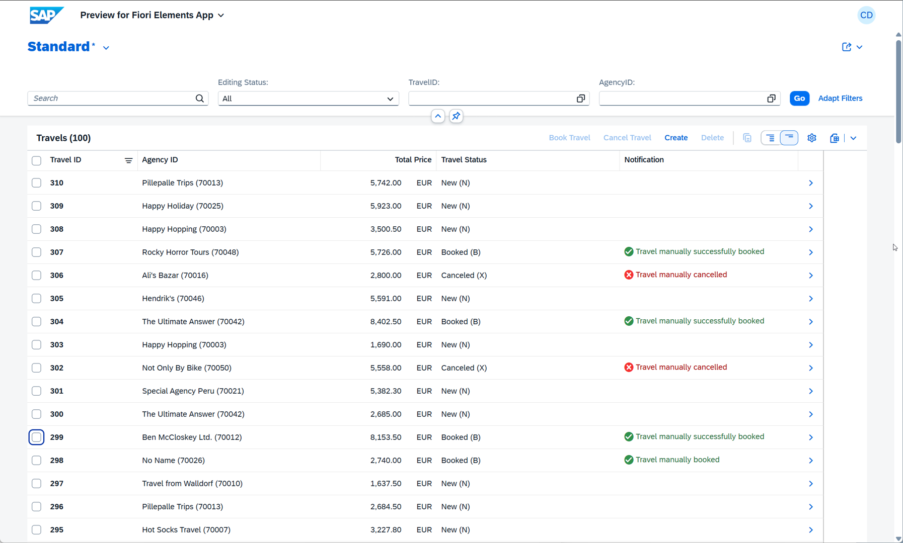
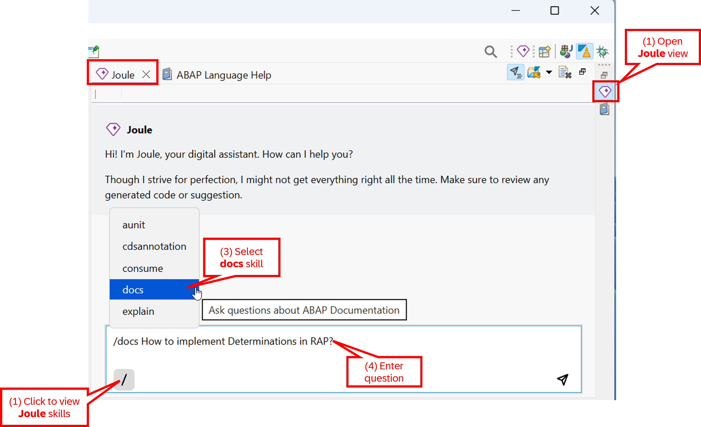
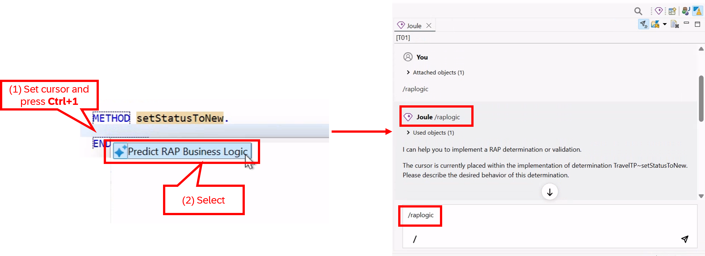
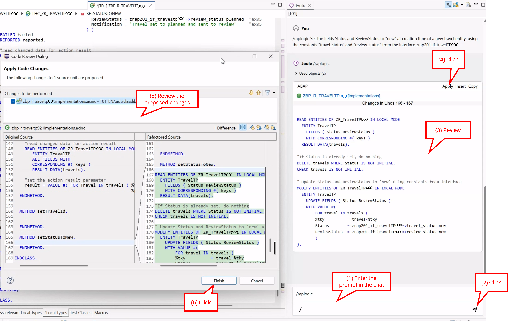

[Home - AD260](../../README.md)

# Exercise 2: Basic Adaptations of the Generated UI Service

## Introduction

In the previous exercise, you've generated a transactional UI service based on a multi-node _Travel_ business object, published it, and populated it with demo data (_see [Exercise 1](../ex01/README.md)_).

In this exercise, you will enhance the functionality of the generated _Travel_ app by enhancing the data model and the transactional behavior of the _Travel_ BO. Specifically, you will enhance the data model and the base BO behavior by adding basic functionalities, including determinations (`setTravelId` and `setStatusToNew`), actions (`bookTravel` and `cancelTravel`), as well as static and dynamic feature controls to the _travel_ entity. You will also enhance the projected _Travel_ BO data model and behavior, as well as improve the UI semantics of the _Travel_ app.

> [!NOTE]
> The purpose of this adaptation is to make the _Travel_ app more feature-rich to serve as foundation for following exercises. These basic capabilities are covered in the beginner hands-on workshop [RAP100 - Build Fiori Apps with the ABAP RESTful Application Programming Model (RAP)](https://github.com/SAP-samples/abap-platform-rap100/blob/main/README.md). Therefore, due to time constraints and in order to focus on new capabilities, you will update the source code of the relevant development objects by simply replacing their source code with the one provided. 

## Exercises

- [2.1 - Enhance the Generated _Travel_ App](#exercise-21-enhance-the-generated-travel-app)
- [2.2 - Preview the Enhanced _Travel_ App](#exercise-22-preview-the-enhanced-travel-app)
- [2.3 - Implement Determinations with 💎Joule (_Optional_)](#exercise-23-implement-determinations-with-joule-optional)
- [Summary & Next Exercise](#summary--next-exercise)

<br/>

> [!TIP]
> <details>
>  <summary>Click to expand ADT tips!</summary>  
>  
> - Always replace all occurrences of the placeholder **`###`** in the provided code snippets with your personal suffix.
> - Use the ADT function _**Find and Replace All**_ (**Ctrl+F**) to quickly replace text in the source code.
> - Use the ADT function _**Quick Fix**_ (**Ctrl+1**), aka _Quick Assist_, on an erroneous element to get help with resolving the issue.
> - Use the **Show ABAP element info** view (**F2**) to inspect an element in ADT editors.
> - Use the **ABAP Formatter** function (**Ctrl+F1**) to format your source code.
>   > You may need to configure the _ABAP Formatter_ and the _DDL Formatter_ if using it for the first time in a given system under the Eclipse menu **Window > Preferences** and navigate to **ABAP Development > Source Code Editor** to configure the _**ABAP Formatter**_ and then go to **> CDS > DDL Formatter**. You can search for _"Formatter"_.   
> - [Useful Keyboard Shortcuts for ABAP Development](https://help.sap.com/docs/ABAP_PLATFORM_NEW/c238d694b825421f940829321ffa326a/4ec299d16e391014adc9fffe4e204223.html?version=latest) (ADT shortcuts)
>
> </details>

---

## Exercise 2.1: Enhance the Generated _Travel_ App
[^Top of page](#)

> Now, enhance the generated _Travel_ app by enhancing the _Travel_ BO behavior with the determinations `setTravelId` and `setStatusToNew`, the actions `bookTravel` and `cancelTravel`, 
> feature controls, as well as adjusting the UI semantics of the _Travel_ app in the metadata extensions.
>
> Due to time restriction, you will simply replace the entire source code of the different development objects with the version provided in the respective source code document. 

<details>
  <summary>🔵 Click to expand!</summary>

### Exercise 2.1.1: Make the Necessary Adaptations  

<details>
  <summary>🟣 Click to expand!</summary>

  <br/>

   Complete the following steps for each development object listed in the table below:
   
   1. Open the development object in the **Project Explorer**.
   
   2. Replace its entire source code with the version provided in the respective 📄source code document. 
   
   3. Replace all occurrences of the placeholder `###` with your personal suffix.
   
   4. Save  (**Ctrl+S**) and activate  (**Ctrl+F3**) the changes. 

      > ⚠️ Make sure to **update the correct artifacts**, as different object types might share the same name.   
      >  - 1, 2, and 3 --> Data model () and behavior ( + ) of **base** _Travel_ BO entity.
      >  - 4 and 5 --> Data model () and behavior () of the **projected** _Travel_ BO entity.
      >  - 6 and 7 --> Metadata extensions () of the **projected** _Travel_ and _Booking_ BO entities.
      >  - ❌ Access controls () are not updated.

      | # | Object Type | Object Name | Source Code Document |
      |---|---|---|---|
      | **1** | **CDS Table Entity** | **`ZR_TRAVELTP###`** | 📄[ex02_ddls_ZR_TRAVELTP.txt](sources/ex02_ddls_ZR_TRAVELTP.txt) |
      | **2** | **CDS Behavior Definition** | **`ZR_TRAVELTP###`** | 📄[ex02_bdef_ZR_TRAVELTP.txt](sources/ex02_bdef_ZR_TRAVELTP.txt)|
      | **3** | **Behavior Implementation Class** - ⚠️ in the **Local Types** tab | **`ZBP_R_TRAVELTP###`** | 📄[ex02_class_ZBP_R_TRAVELTP.txt](sources/ex02_class_ZBP_R_TRAVELTP.txt) |
      |---|---|---|---|
      | **4** | **CDS Projection View** | **`ZC_TRAVELTP###`** | 📄[ex02_ddls_ZC_TRAVELTP.txt](sources/ex02_ddls_ZC_TRAVELTP.txt) |
      | **5** | **CDS Projection Behavior Definition** | **`ZC_TRAVELTP###`** | 📄[ex02_bdef_ZC_TRAVELTP.txt](sources/ex02_bdef_ZC_TRAVELTP.txt) |
      |---|---|---|---|
      | **6** | **CDS Metadata Extensions** | **`ZC_TRAVELTP###`** | 📄[ex02_ddlx_ZC_TRAVELTP.txt](sources/ex02_ddlx_ZC_TRAVELTP.txt) |
      | **7** | **CDS Metadata Extensions** | **`ZC_BOOKINGTP###`** | 📄[ex02_ddlx_ZC_BOOKINGTP.txt](sources/ex02_ddlx_ZC_BOOKINGTP.txt) |   

<br/>

</details>  

### Exercise 2.1.2: Understand the Adaptations  

> You can skip the following explanation of the different adaptations and proceed directly to step 2.2. to preview the enhanced _Travel_ app in the browser.

<details>
  <summary>🟣 Click to expand!</summary>

<br/>

**A) Adaptation of the Base _Travel_ BO**

The associations **`_Agency`**, **`_Customer`**, and **`_TravelStatus`** have been added to the data model of the _travel_ entity, i.e., in the base CDS table entity **`ZR_TRAVELTP###`**. This was done to complete the data model (reflecting associated entities) and will be used in the projection layer to de-normalize the related texts.   
      
The following enhancements have been defined in the base behavior definition **`ZR_TRAVELTP###`** and implemented in the behavior pool  **`ZBP_R_TRAVELTP###`**: 
     
   - Determination **`setTravelId`**: to set the field `TravelID` with a unique semantic ID at creation time of a new _travel_ entity.
   - Determination **`setStatusToNew`**: to set the field `Status` to _New_ (`N`) at creation time of a new _travel_ entity.
   - Action **`bookTravel`**: to set the field `Status` to _Booked_ (`B`) of a _travel_ entity.
   - Action **`cancelTravel`**: to set the field `Status` to _Cancelled_ (`X`) of a _travel_ entity.
   - Dynamic feature control:
     - to disable the **_Book Travel_** button when `Status` is set to _Cancelled_ (`X`) or `ReviewStatus` is set to _Planned_ (`2`)
     - to disable the **_Cancel Travel_** button when a _travel_ record is set to _Booked_ (`B`) or `ReviewStatus` is set to _Planned_ (`2`)
     - to disable the **_Edit_** button when `Status` is set to _Booked_ (`B`) or `ReviewStatus` is set to _Planned_ (`2`)

<br/>

**B) Adaptation of the _Travel_ BO Projection (_consumption layer_)**

The following data model adjustments have been done in **`ZC_TRAVELTP###`**: 
- **Value helps** have been defined for the fields `AgencyID`, `CustomerID`, and `Status`.
- **New fields** have been added: `AgencyName`, `CustomerName`, and `TravelStatusText`, and defined as associated text to `AgencyID`, `CustomerID`, and `Status` respectively
- The view is now defined as **searchable** and full-text search is enabled for the fields: `TravelID`, `AgencyID`, and `Customer ID`.
- **Removal** of some admin fields `LocalCreatedBy`, `LocalCreatedAt`, `LocalLastChangedBy`, and `LastChangedAt`.

Following adjustments have been defined in the behavior projection **`ZC_TRAVELTP###`**:
- **Exposure** of both actions `bookTravel` and `cancelTravel`
- **Field control**: The fields `TravelID`, `Status`, `ReviewStatus`, and `Notification` have been set to read-only.

<br/>

**C) Adaptation of the UI Semantics**

Various adjustments to the UI semantics of the _Travel_ app have been defined at the consumption layer for the BO Projection **`ZC_TRAVELTP###`** using the metadata extensions **`ZC_TRAVELTP###`** and **`ZC_BOOKINGTP###`**. The adjustments include the display of both actions **`bookTravel`** and **`cancelTravel`** on the UI.

<br/>

</details>    

</details> 


## Exercise 2.2: Preview the Enhanced _Travel_ App
[^Top of page](#)

> Preview the enhanced _Travel_ app with the new determination, actions, and feature control.

<details>
  <summary>🔵 Click to expand!</summary>

1. Refresh the app in the browser, or restart the app preview by going to the service binding **`ZUI_TRAVELTP_O4###`** in the **Project Explorer**, selecting the **Travel** entity (leading entity), and starting the **SAP Fiori Elements App Preview**.

3. Press **Go** to load the data in the app in the browser, and play around with the enhanced app.

4. Verify that:
   - The **Book Travel** and **Cancel Travel** buttons appear.
   - Dynamic feature control disables the appropriate buttons based on the travel status.
   - The fields **Status** and **Travel ID** are read-only.
   - The **Status** field is set to **N** (_New_) at creation.
   - The **Travel ID** field is set at creation.
     
     <br/>

         
   
<br/>

</details>


## Exercise 2.3: Implement Determinations with 💎Joule (_Optional_) 
[^Top of page](#)
 
> Implement logic of one of the determinations, `setTravelId` and `setStatusToNew`, that have been defined in the previous step using the ABAP AI capabilities in SAP Joule for Developers.  

> [!NOTE]
> Please note that this step is **optional**, as a basic implementation of both determination has already been provided in the previous step.
> However, you may delete the current implementations and reimplement them using 💎Joule if you wish. A backup implementation is provided for each determination.

<details>
  <summary>🔵 Click to expand!</summary>

1. Go to your behavior implementation class **`ZBP_R_TRAVELTP###`** and navigate to the local handler class **`lhc_zr_travelTP###`** on the **Local Types** tab.

2. Use the **documentation chat** capability in 💎**Joule** to obtain information about the implementation of determinations or any other RAP topics.

   > 💡 The **documentation chat** (`/docs`) is a capability in SAP Joule for Developers, ABAP AI capabilities. It allows you to chat with documentation on the SAP Help Portal. ([Learn more...](https://help.sap.com/docs/abap-cloud/abap-development-tools-user-guide/docchat))
   
   To achieve this, open the 💎**Joule** view, go to the chat, select **docs** as topic or skill, and enter the question below to request information about the implementation of RAP determinations:  
   
   ```
   How to implement determinations in RAP?
   ```

    
   
3. Now proceed with the implementation of the determination **`setStatusToNew`**, which sets the **`Status`** field to _New_ (**`N`**) at the creation time of a new _travel_ entity.
      
   To achieve this, 
   - go to the **`setStatusToNew`** method implementation,
   - delete the current implementation,
   - set the cursor in the empty method,
   - press **Ctrl+1** to open the **Quick Fix** view,
   - select the **Predict RAP Business Logic** entry to start the **`/raplogic`** skill in the 💎Joule chat.

     > 💡 The **RAP business logic prediction** (`/raplogic`) is a capability in SAP Joule for Developers, ABAP AI capabilities. It supports you in implementing determinations or validations in the implementation class of your behavior definition.([Learn more...](https://help.sap.com/docs/abap-cloud/abap-development-tools-user-guide/rap-business-logic-prediction))     

       

   Now, 
   - Insert the prompt below in the 💎Joule chat, and
   - replace ### with your group-id and
   - press **Enter** or click the **Send** icon.   
     
     ```
     Set the fields Status and ReviewStatus to "new" at creation time of a new travel entity, 
     using the constants "travel_status" and "review_status" from the interface zrap201_if_travelTP###.
     ```
  
     After a few seconds, 💎Joule will suggest an implementation. 
     
     Now,
     - Review the code suggestion in the 💎Joule view,
     - Press **Apply** to insert it into the editor,
     - Review the changes that will be applied in the **Code Review Dialog**, and
     - press **Finish** to confirm the changes. 

       > 💡 If an error is displayed in the editor, make sure the correct artifact and field names are used in the porposed business logic.
    
         
    
   <br/>
   
   <details>
      <summary>ℹ️ Click to expand the backup implementation for `setStatusToNew ()`!</summary>
      
    ```abap
      METHOD setStatusToNew.
        "read travel instance(s) of the transferred keys
        READ ENTITIES OF ZR_TravelTP### IN LOCAL MODE
         ENTITY TravelTP
           FIELDS ( Status ReviewStatus )
           WITH CORRESPONDING #( keys )
         RESULT DATA(travels)
         FAILED DATA(read_failed).
    
        "if travel status is already set, do nothing, i.e. remove such instances
        DELETE travels WHERE Status IS NOT INITIAL.
        CHECK travels IS NOT INITIAL.
    
        "else set travel status to new ('N')
        MODIFY ENTITIES OF ZR_TravelTP### IN LOCAL MODE
          ENTITY TravelTP
            UPDATE FIELDS ( Status ReviewStatus )
            WITH VALUE #( FOR TravelTP IN travels ( %tky         = travelTP-%tky
                                                    Status       = zrap201_if_travelTP###=>travel_status-new
                                                    ReviewStatus = zrap201_if_travelTP###=>review_status-new  ) )
        REPORTED DATA(update_reported).
    
        "set the changing parameter
        reported = CORRESPONDING #( DEEP update_reported ).
      ENDMETHOD.   
    ```
   </details>
    
    
4. **Implement the determination `setTravelId`**, which determines the value of the **`TravelID`** field (used as semantic key) at the creation time of a new _travel_ entity.

   To achieve this, 
   - go to the **`setTravelId`** method implementation,
   - delete the current implementation,
   - in the empty method,
   - press **Ctrl+1** to open the **Quick Fix** view,
   - select the **Predict RAP Business Logic** entry to start the **`/raplogic`** skill in the 💎Joule chat.
   
   Then, 
   - Insert the prompt below in the 💎Joule chat, and
   - replace ### with your group-id and
   - press **Enter** or click the **Send** icon.
   
     ```
     Fill the semantic ID field "TravelID" for every newly created Travel instance.
     No number range object is required.
     Determine the next Travel ID by selecting the highest travel ID from both active and draft Travel entities.
     The persistency for the active Travel entity is "ZR_TRAVELTP###" with field "TravelId".       
     The persistency for the draft Travel entity is "ZR_TRAVELTP_D###" with field "TravelId".
     ```

     After a few seconds, 💎Joule will suggest an implementation. 
     
     Now,
     - Review the code suggestion in the 💎Joule view,
     - Press **Apply** to insert it into the editor,
     - Review the changes that will be applied in the **Code Review Dialog**, and
     - press **Finish** to confirm the changes. 

       > 💡 If an error is displayed in the editor, make sure the correct artifact and field names are used in the porposed business logic.

    <br/>
   
    <details>
      <summary>ℹ️ Click to expand the backup implementation for `setTravelId()`!</summary>
      
    ```abap
      METHOD setTravelId.
        "Fill the unique semantic ID field TravelId for every newly created Travel instance. No number range object is required. The persistency for the Travel entity is ZR_TRAVELTP###.
    
        "read travel instance(s) of the transferred keys
        READ ENTITIES OF ZR_TravelTP### IN LOCAL MODE
         ENTITY TravelTP
           FIELDS ( TravelID )
           WITH CORRESPONDING #( keys )
         RESULT DATA(travels).
    
        "if travel id is already set, do nothing, i.e. remove such instances
        DELETE travels WHERE TravelID IS NOT INITIAL.
        CHECK travels IS NOT INITIAL.
    
        "get highest active travel id
        SELECT MAX( TravelId ) FROM ZR_TravelTP### INTO @DATA(lv_travel_id).
    
        "get highest draft travel id
        SELECT MAX( TravelId ) FROM zr_travelTP_d### INTO @DATA(lv_traveld_id).
    
        IF lv_traveld_id > lv_travel_id.
          lv_travel_id = lv_traveld_id.
        ENDIF.
    
        "set the travel id for the remaining instances
        MODIFY ENTITIES OF ZR_TravelTP### IN LOCAL MODE
          ENTITY TravelTP
            UPDATE FIELDS ( TravelID )
            WITH VALUE #( FOR travel IN travels ( %tky     = travel-%tky
                                                  TravelID = lv_travel_id + 1 ) ).
    
      ENDMETHOD.  
    ```
    </details>   
   
9. Play around with the enhanced app to test the implementation. You simply need to create a new travel record 
   and check if the **Travel ID** and the **Travel Status** have been set at creation.
   
<br/>

</details>


## Summary & Next Exercise
[^Top of page](#introduction)

Now that you've...
- enhanced the behavior definition with determinations, actions, and feature control,
- implemented the business logic in the behavior pool,
- exposed the actions in the behavior projection,
- enhanced the data model of the projected BO, and
- improved the UI with metadata extensions,

you can continue with the next exercise – **[Exercise 3: Enable the Collaborative Draft Handling](../ex03/README.md)**

---
