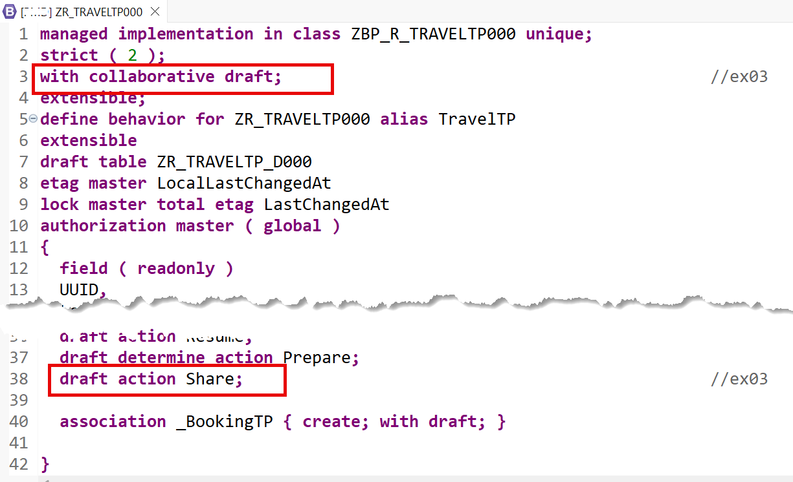
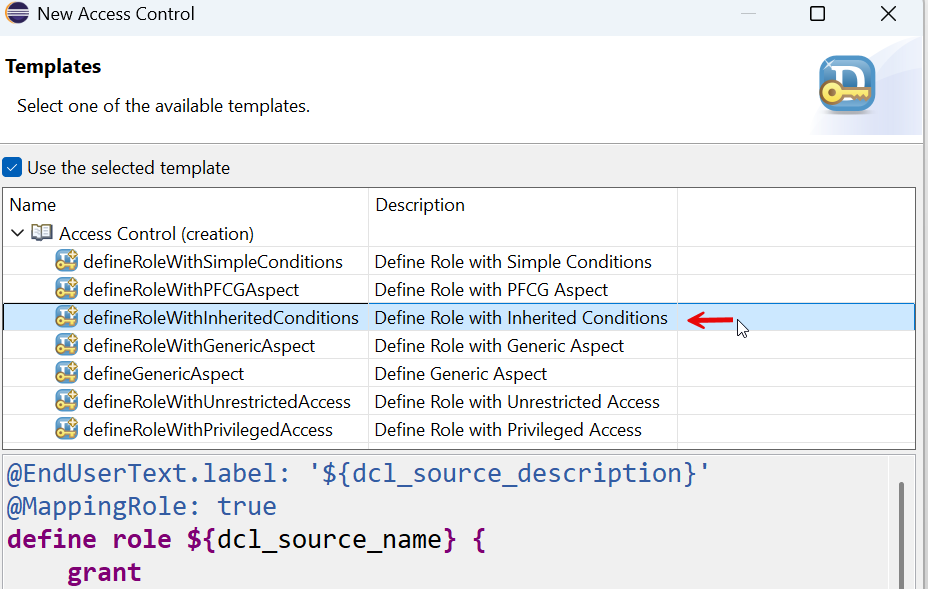
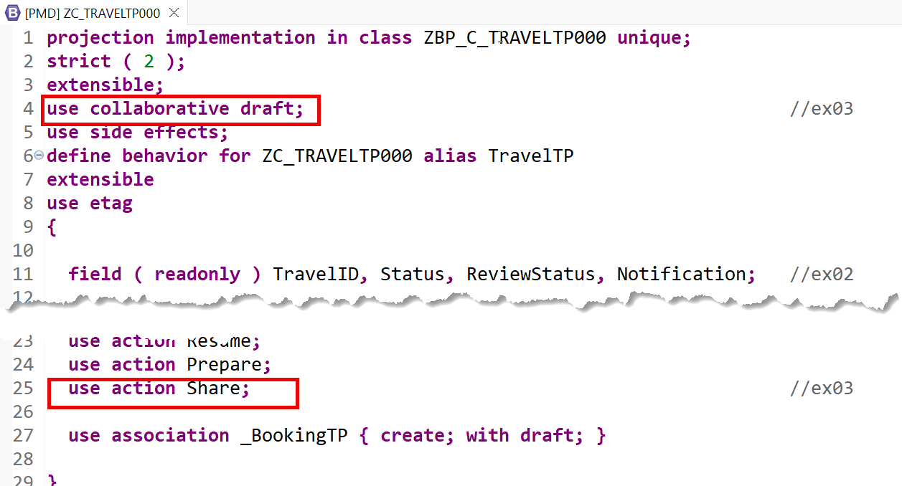
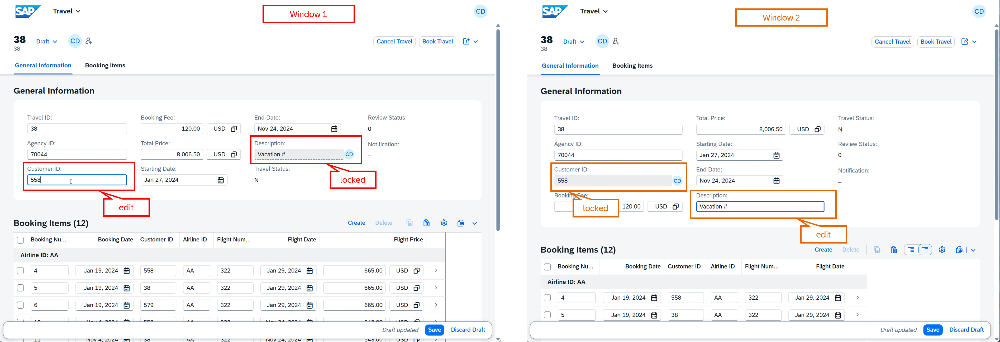

[Home - AD260](../../README.md)

# Exercise 3: Enable the Collaborative Draft Handling

## Introduction

In the previous exercise, you've enhanced the RAP BO with determinations, actions, dynamic feature control, and metadata extensions (_see [Exercise 2](../ex02/README.md)_).

In this exercise, you will add the collaborative draft handling to the _Travel_ application. This enables multiple users to work on the same business object instance simultaneously. 

## Exercises

- [3.1 - Adjust the Base _Travel_ BO ](#exercise-31-adjust-the-base-travel-bo)
- [3.2 - Adjust the _Travel_ BO  Behavior Projection (_Optional_)](#exercise-32-adjust-the-travel-bo-behavior-projection)
- [3.3 - Preview the Enhanced _Travel_ App](#exercise-33-preview-the-enhanced-travel-app)
- [Summary & Next Exercise](#summary--next-exercise)
  
<br/>

> [!TIP]
> <details>
>  <summary>Click to expand ADT tips!</summary>  
>  
> - Always replace all occurrences of the placeholder **`###`** in the provided code snippets with your personal suffix.
> - Use the ADT function _**Find and Replace All**_ (**Ctrl+F**) to quickly replace text in the source code.
> - Use the ADT function _**Quick Fix**_ (**Ctrl+1**), aka _Quick Assist_, on an erroneous element to get help with resolving the issue.
> - Use the **Show ABAP element info** view (**F2**) to inspect an element in ADT editors.
> - Use the **ABAP Formatter** function (**Ctrl+F1**) to format your source code.
> - [Useful Keyboard Shortcuts for ABAP Development](https://help.sap.com/docs/ABAP_PLATFORM_NEW/c238d694b825421f940829321ffa326a/4ec299d16e391014adc9fffe4e204223.html?version=latest) (ADT shortcuts)
>
> </details>

> [!NOTE]
> **About the Collaborative Draft Handling**
> 
> <details>
>  <summary>Click to expand!</summary>  
>
>  <br/>
>  
>  **Collaborative draft** allows multiple users to work concurrently on the same draft instance. All authorized users can make changes, 
  view updates in real time, and work together on the draft without locking each other out. The creator of the draft instance and all other authorized users are allowed to modify, activate, 
  or discard the draft instance.
>
> You can enable a collaborative draft handling by using the keyword `with collaborative draft` in the behavior definition header of a behavior definition of a managed or unmanaged RAP business object.
>   
> Collaborative draft is available in SAP Business AI Platform, ABAP environment, SAP S/4HANA Cloud Public Edition, and SAP S/4HANA Cloud Private Edition 2025 onwards.
>  
> **Learn more:** [Draft](https://help.sap.com/docs/abap-cloud/abap-rap/draft) | [Draft Handling](https://help.sap.com/docs/abap-cloud/abap-rap/draft-handling) 
>  </details>

---

## Exercise 3.1: Adjust the Base _Travel_ BO

> Enable the collaborative draft capabilities for the _Travel_ BO `ZR_TRAVELTP###`.

> [!NOTE]  
> With **CDS table entities** providing persistency for draft data in this scenario, there is no need to create draft query views, as you might be used to when working with DDIC tables as persistency. 
> Access controls for the draft table entities can be defined for the implementation of read access restrictions.  

<details>
  <summary>🔵 Click to expand!</summary>

### Exercise 3.1.1: Adjust the Base _Travel_ BO Behavior

> Adjust the definition of the behavior definition, which currently uses the exclusive draft handling.

<details>
  <summary>🟣 Click to expand!</summary>

1. Open the behavior definition **`ZR_TRAVELTP###`**.

2. Use 💎**Joule** to obtain information about the implementation of the collaborative draft handling.
   
   To achieve this,
   - open the 💎**Joule** view,
   - go to the chat,
   - select **docs** as topic (aka skill), and
   - enter the question below:  
   
     ```
     What is required to enable this BO for collaborative draft?
     ```

   Now, proceed with defining the collaborative draft.

4. Replace the **`with draft;`** statement in the header section with the one below: 
   
   ```abap
   with collaborative draft;                                            //ex03
   ```

5. Now, add the draft action **`Share`** after the draft determine action **`Prepare`** (i.e. after **`draft determine action Prepare;`**) with the code snippet below:

   ```abap
     draft action Share;                                                //ex03
   ```
   
   The changed lines are shown highlighted in the screenshot below.

       

   <br/>

   Expand to see how the updated source code of the behavior definition  **`ZR_TRAVELTP###`** should now look like.  
   
   <details>
     <summary>ℹ️ Click to expand and see the resulting source code!</summary>   
     <br/>
     
     ```abap     
     managed implementation in class ZBP_R_TRAVELTP### unique;
     strict ( 2 );
     with collaborative draft;                                            //ex03
     extensible;
     define behavior for ZR_TRAVELTP### alias TravelTP
     extensible
     draft table ZR_TRAVELTP_D###
     etag master LocalLastChangedAt
     lock master total etag LastChangedAt
     authorization master ( global )
     {
       field ( readonly )
       UUID,
       LocalCreatedBy,
       LocalCreatedAt,
       LocalLastChangedBy,
       LocalLastChangedAt,
       LastChangedAt;
      
       field ( numbering : managed )
       UUID;
      
       create;
       update ( features : instance );                                    //ex02
       delete ( features : instance );                                    //ex02
      
       determination setTravelId on modify { create; }
       determination setStatusToNew on modify { create; }                 //ex02
      
       action ( features : instance ) bookTravel result [1] $self;        //ex02
       action ( features : instance ) cancelTravel result [1] $self;      //ex02
      
       draft action Activate optimized;
       draft action Discard;
       draft action Edit;
       draft action Resume;
       draft determine action Prepare;
       draft action Share;                                               //ex03
      
       association _BookingTP { create; with draft; }
      
     }
      
     define behavior for ZR_BOOKINGTP### alias BookingTP
     extensible
     draft table ZR_BOOKINGTP_D###
     etag dependent by _TravelTP
     lock dependent by _TravelTP
     authorization dependent by _TravelTP
     {
       field ( readonly )
       UUID,
       ParentUUID;
      
       field ( numbering : managed )
       UUID;
      
       update;
       delete;
      
       association _TravelTP { with draft; }
      
     }     
     ```
             
   </details>   
        
6. Save  (**Ctrl+S**) and activate  (**Ctrl+F3**) the changes.
 
<br/>

</details>


### Exercise 3.1.2: Define Access Control for the Draft Tables (_Optional_)

> You will now define access control to secure access to the draft table entities associated with the active _Travel_ table entities. The access control objects must inherit the access conditions from the respective base table entities.

> ℹ️ **Note:** This step is **optional** in this exercise, as we do not use any authorization objects here. You may skip it to save time. 

<details>
  <summary>🟣 Click to expand!</summary>
  
1. Create the access control object **`ZR_TRAVELTP_D###`** to secure access to the draft table entity **`ZR_TRAVELTP_D###`**.

   To achieve this,
   - go to your exercise package in the **Project Explorer**,
   - navigate to the data definition **`ZR_TRAVELTP_D###`**,
   - right-click on it, and
   - select **New Access Control** from the context menu to start the creation dialog.

2. Enter the following values in the creation dialog:
  
   | Field | Value |
   |---|---|
   | Name | **`ZR_TRAVELTP_D###`** |
   | Description | **`Access control for ZR_TRAVELTP_D###`** |     
   | Protected Entity | **`ZR_TRAVELTP_D###`** (_value should already be prefilled_) |    

3. Now, 
   - click **Next >** to continue,
   - select a transport request if needed,
   - click **Next >** to continue,
   - select the template **defineRoleWithInheritedConditions**, and
   - press **Finish** to confirm the creation. 

         

4. Replace the placeholder **`cds_source_entity`** with the name of the **base** BO table entity **`ZR_TRAVELTP###`** from which the access conditions should be inherited.   

   ℹ️ The source code of the access control **`ZR_TRAVELTP_D###`** should look as follows:
   
   ```abap
   @EndUserText.label: 'Access control for ZR_TRAVELTP_D###'
   @MappingRole: true
   define role ZR_TRAVELTP_D### {
       grant  
       select
         on
           ZR_TRAVELTP_D###
             where
               inheriting conditions from entity ZR_TRAVELTP###;
                
   }
   ```

5. Save  (**Ctrl+S**) and activate  (**Ctrl+F3**) the changes

6. Now, create the access control **`ZR_BOOKINGTP_D###`** for the draft table entity of the _Booking_ entity.

   To achieve this,
   - go to your exercise package in the **Project Explorer**,
   - navigate to the CDS data definition **`ZR_BOOKINGTP_D###`**,
   - right-click on it, and
   - select **New Access Control** from the context menu to start the creation dialog.

7. Enter the following values in the creation dialog:

   | Field | Value |
   |---|---|
   | Name | **`ZR_BOOKINGTP_D###`** |
   | Description | **`Access control for ZR_BOOKINGTP_D###`** |     
   | Protected Entity | **`ZR_BOOKINGTP_D###`** (_value should already be prefilled_) |       

8. Now, 
   - click **Next >** to continue,
   - select a transport request if needed,
   - click **Next >** to continue,
   - select the template **defineRoleWithInheritedConditions**, and 
   - press **Finish** to confirm the creation. 

9. Replace the placeholder **`cds_source_entity`** with the name of the base BO view entity **`ZR_BOOKINGTP###`** from which the access conditions should be inherited.   

   ℹ️ The source code of the access control **`ZR_BOOKINGTP_D###`** now look as follows:    
   
   ```abap
   @EndUserText.label: 'Access control for ZR_BOOKINGTP_D###'
   @MappingRole: true
   define role ZR_BOOKINGTP_D### {
       grant  
       select
         on
           ZR_BOOKINGTP_D###
             where
               inheriting conditions from entity ZR_BOOKINGTP###;
                
   }
   ```

   <br/>  

</details>

</details>


## Exercise 3.2: Adjust the _Travel_ BO Behavior Projection

> Expose the collaborative draft handling, including the `Share` draft action, in the behavior definition `ZC_TRAVEL###` of the _Travel_ BO Projection.

<details>
  <summary>🔵 Click to expand!</summary>
  
1. Open the behavior definition **`ZC_TRAVELTP###`** in the **Project Explorer**.

2. Expose the collaborative draft handling by replacing **`use draft;`** with:

   ```abap
     use collaborative draft;
   ```

3. Expose the draft action **`Share`**  with the keyword **`use`**:

   ```abap
     use action Share;
   ```

   The changed lines are highlighted with `//ex03` on the screenshot below.

       
   
   ℹ️ **Expand** to see how the updated source code of the behavior definition  **`ZC_TRAVELTP###`** should now look like:
   
   <details>
     <summary>Click to expand!</summary>   
     <br/>

     ```abap     
     projection implementation in class ZBP_C_TRAVELTP### unique;
     strict ( 2 );
     extensible;
     use collaborative draft;                                             //ex03
     use side effects;
     define behavior for ZC_TRAVELTP### alias TravelTP
     extensible
     use etag
     {
      
       field ( readonly ) TravelID, Status, ReviewStatus, Notification;   //ex02
      
       use create;
       use update;
       use delete;
      
       use action bookTravel;
       use action cancelTravel;
      
       use action Edit;
       use action Activate;
       use action Discard;
       use action Resume;
       use action Prepare;
       use action Share;                                                  //ex03     
      
       use association _BookingTP { create; with draft; }
      
     }
      
     define behavior for ZC_BOOKINGTP### alias BookingTP
     extensible
     use etag
     {
       use update;
       use delete;
      
       use association _TravelTP { with draft; }
      
     }
     ```
          
   </details>    

4. Save  (**Ctrl+S**) and activate  (**Ctrl+F3**) the changes.

<br/>

</details>


## Exercise 3.3: Preview the Enhanced _Travel_ App

> Preview the app with collaborative draft handling enabled.

<details>
  <summary>🔵 Click to expand!</summary>

1. Refresh the app in the browser, or go to the **Service Binding**, select the **Travel** entity (leading entity) and start the **SAP Fiori Elements App Preview**.

2. Press **Go** to load the data in the app.

3. Verify that:
   - Multiple users can now collaborate on the same draft instance.
   - The **Share** action is available when editing a Travel instance and can be used to invite other authorized users.
   - Changes made by another user or in another browser session can be seen in real time and the specific fields are temporarily locked.

     >💡**Hint:**  You can test this feature by using two different users **or** simply by opening the _Travel_ app in two separate browsers, then editing the same _travel_ record in both sessions.

     <br/>

      

<br/>
</details>

## Summary & Next Exercise
[^Top of page](#introduction)

Now that you've...
- created access controls for the draft table entities,
- enabled collaborative draft in the behavior definitions and projection, and
- exposed the Share action,

you can continue with the next exercise – **[Exercise 4: Add Event-Driven RAP Side Effects](../ex04/README.md)**

---
