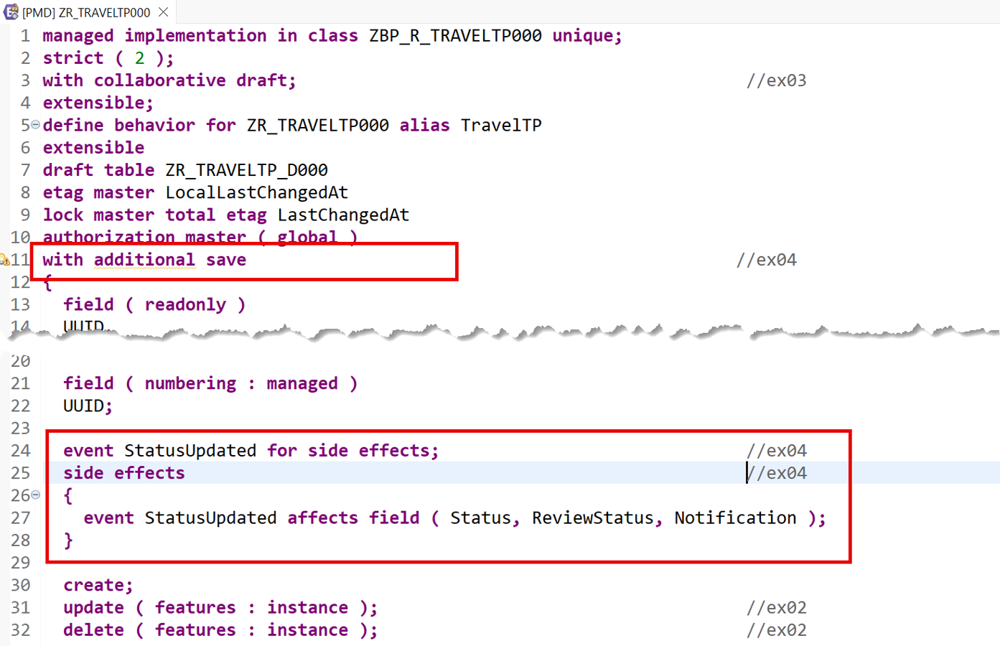
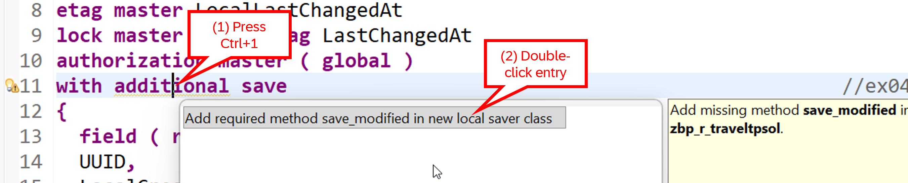
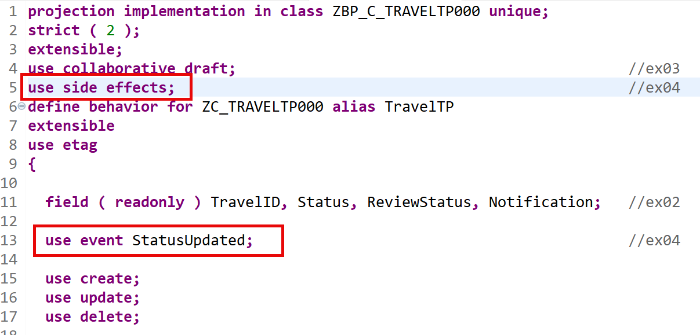
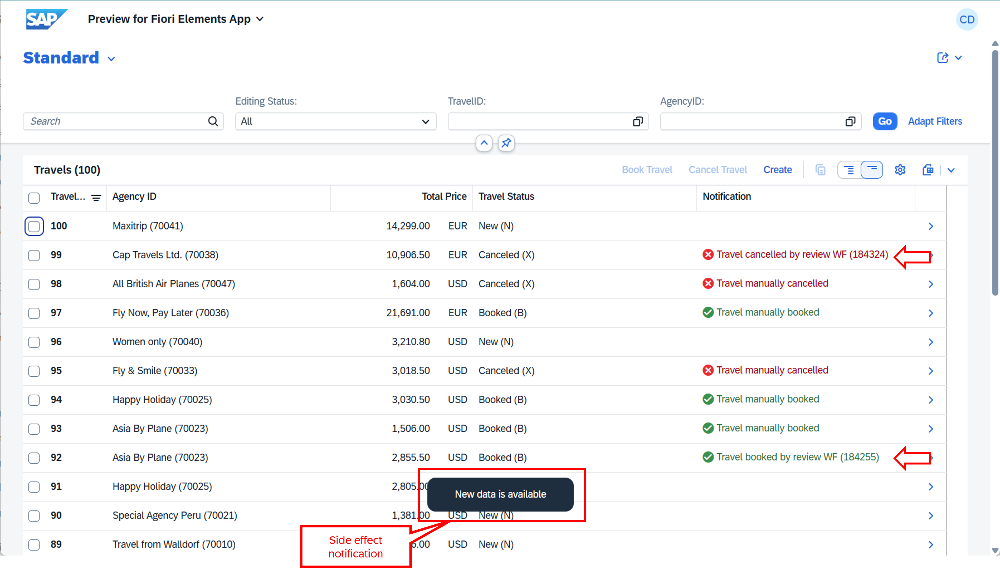

[Home - AD260](../../README.md)

# Exercise 4: Add Event-Driven RAP Side Effects

## Introduction

In the previous exercise, you've added collaborative draft handling to the Travel application (_see [Exercise 3](../ex03/README.md)_).

In this exercise, you will add an event-driven RAP side effect to the _travel_ root entity to reload specific information in the _Travel_ app at a particular business event, without reloading the entire data. To achieve this, you will define and implement a business event called `StatusUpdated` and specify event-driven side effects to refresh the fields `Status`, `ReviewStatus`, and `Notification` whenever this event is raised. 

Additionally, you will create a class to simulate an external update of the travel status via an EML (Entity Manipulation Language) call.

## Exercises

- [4.1 - Define the Event-Driven RAP Side Effect in the Base _Travel_ BO Behavior](#exercise-41-define-the-event-driven-rap-side-effect-in-the-base-travel-bo-behavior)
- [4.2 - Raise the Event in the _Travel_ Behavior Pool](#exercise-42-raise-the-event-in-the-travel-behavior-pool)
- [4.3 - Expose the Event-Driven Side Effect in the _Travel_ BO Projection](#exercise-43-expose-the-event-driven-side-effect-in-the-travel-bo-projection)
- [4.4 - Create an ABAP Class Simulating an External EML Call](#exercise-44-create-an-abap-class-simulating-an-external-eml-call)
- [4.5 - Preview the Enhanced Travel App](#exercise-45-preview-the-enhanced-travel-app)
- [Summary & Next Exercise](#summary--next-exercise)

<br/>

> [!TIP]
> <details>
>  <summary>Click to expand ADT tips!</summary>  
>  
> - Always replace all occurrences of the placeholder **`###`** in the provided code snippets with your personal suffix.
> - Use the ADT function _**Find and Replace All**_ (**Ctrl+F**) to quickly replace text in the source code.
> - Use the ADT function _**Quick Fix**_ (**Ctrl+1**), aka _Quick Assist_, on an erroneous element to get help with resolving the issue.
> - Use the **Show ABAP element info** view (**F2**) to inspect an element in ADT editors.
> - Use the **ABAP Formatter** function (**Ctrl+F1**) to format your source code.
> - [Useful Keyboard Shortcuts for ABAP Development](https://help.sap.com/docs/ABAP_PLATFORM_NEW/c238d694b825421f940829321ffa326a/4ec299d16e391014adc9fffe4e204223.html?version=latest) (ADT shortcuts)
>
> </details>

> [!NOTE]
> **About Event-Driven Side Effects**
> 
> <details>
>  <summary>Click to expand!</summary>  
>
>  <br/>
>  
> RAP Side effects (hereafter: side effect) are used to reload data, permissions, or messages or trigger determine actions based on data changes in UI scenarios with draft-enabled BOs. Since draft-enabled scenarios use a stateless communication pattern, the UI doesn't trigger a reload of all BO-related properties for every user input. In particular, RAP side effects are efficient since there is no full reload of all BO-properties, but only of those that are affected by particular user input.
> Different types of RAP side effects are available.
> 
>  **An event-driven side effect** is a side effect that is triggered whenever a defined business event (hereafter: event) is raised by the application server to reload the defined targets.
>   
> Event-driven side effects are available in SAP Business AI Platform, ABAP environment, SAP S/4HANA Cloud Public Edition, and SAP S/4HANA Cloud Private Edition 2025 onwards.
>  
> **Learn more:** [RAP Side Effects](https://help.sap.com/docs/abap-cloud/abap-rap/side-effects) | [Developing RAP Side Effects](https://help.sap.com/docs/abap-cloud/abap-rap/developing-side-effects)
>  </details>

---

## Exercise 4.1: Define the Event-Driven RAP Side Effect in the Base _Travel_ BO Behavior

> Define and implement an event-driven RAP Side Effects in the base behavior definition `ZR_TravelTP###` to refresh the fields `Status`, `ReviewStatus`, and `Notification` whenever the `StatusUpdated` event is raised.
> 
> For that, you will define the event for RAP side effects `StatusUpdated` and an event-driven RAP side effect to refresh the fields when the event is triggered. Then you will implement the `save_modified` method in a local saver class to raise the event during the save sequence in the behavior pool `ZBP_R_TRAVELTP###`. 

<details>
  <summary>🔵 Click to expand!</summary>

1. Open the behavior definition **`ZR_TravelTP###`** in the **Project Explorer**.

2. First of all, use the **documentation chat capability** in  💎**Joule** to obtain information about the implementation of RAP side effects.
   
   To achieve this, open the 💎**Joule** view, go to the chat, select the **docs** skill, and enter the prompt below:  
   
     ```
     I want to implement event driven side effects for this BO.
     The side effect should affect the fields Status, ReviewStatus and Notification.
     The event triggering the side effect is "StatusUpdated".
     ```

   Review Joule's answer and then proceed with the definition.

3. Add the event definition for side effects **`StatusUpdated`** to the behavior definition of the _Travel_ BO entity **`ZR_TravelTP###`** using the code snippet below.

   ```abap
     event StatusUpdated for side effects;
   ```       

4. Add the statement **`with additional save`** after the keyword **`managed`** in the header section of the behavior definition using the code snippet below. 

   > 💡 Business events must be raised in the save sequence. In case of _managed_ implementation, the statement `with additional save` or `with unmanaged save`
   > needs to be added to the behavior definition to raise an event.

   ```abap
     with additional save
   ```   

5. Add the event-driven side effects using the code snippet below. 

   ```abap
     side effects
     {
       event StatusUpdated affects field ( Status, ReviewStatus, Notification );
     }
   ```
     
6. You can take a look at the changed lines in the behavior definition `ZR_TravelTP###` in the screenshot or the document linked below:

    
   
   > ℹ️📄Source code document: [ex04_bdef_ZR_TravelTP###.txt](sources/ex04_bdef_ZR_TRAVEL.txt)
   
7. Save  (**Ctrl+S**) and activate  (**Ctrl+F3**) the changes.

<br/>

</details>


## Exercise 4.2: Raise the Event in the _Travel_ Behavior Pool

> Add the local saver class `lsc_zr_traveltp###` and implement the Additional Save Logic in the `save_modified` method to raise the event during the save sequence in the _travel_ behavior pool `ZBP_R_TRAVELTP###`.

<details>
  <summary>🔵 Click to expand!</summary>

1. Go to the behavior definition **`ZR_TravelTP###`**.

2. Use the ADT quick fix to add the definition of the local saver class **`lsc_zr_traveltp###`** of the behavior pool **`ZBP_R_TRAVELTP###`** and the  **`save_modified`** method.

   To achieve this,
   - set the cursor on the statement **`additional save`**,
   - press **Ctrl+1** to trigger the quick fix view, and
   - double-click the entry to add the missing method **`save_modified`** in a new local saver class inside global class **`ZBP_R_TRAVELTP###`**.

      

   The behavior implementation class will be updated with the local saver handler class and the method definition.

3. Navigate to the local saver class **`lsc_zr_traveltp###`** in the behavior pool **`ZBP_R_TRAVELTP###`** on the **Local Types** tab.

4. Implement the method **`save_modified`** with the source code provided below.   

   Remember to replace all occurrences of **`###`** with your personal suffix.

   ```abap
    METHOD save_modified.
      DATA: Travels             TYPE STANDARD TABLE OF ZR_TravelTP###,
            Travel              TYPE                   ZR_TravelTP###,
            events_to_be_raised TYPE TABLE FOR EVENT ZR_TravelTP###~StatusUpdated.

      "raise the event whenever the status is changed
      IF update-traveltp IS NOT INITIAL.
  
        events_to_be_raised = VALUE #( FOR trvl IN update-traveltp
                                       WHERE ( %control-ReviewStatus = if_abap_behv=>mk-on )
                                       ( CORRESPONDING #( trvl ) ) ).

        IF events_to_be_raised IS NOT INITIAL.
          RAISE ENTITY EVENT ZR_TravelTP###~StatusUpdated FROM events_to_be_raised.
        ENDIF.

      ENDIF.
    ENDMETHOD.
   ```

5. You can take a look at the entire updated source code of `ZBP_R_TRAVELTP###` in the document linked below:

   > ℹ️📄Source code document: [ex04_class_ZBP_R_TRAVELTP###.txt](sources/ex04_class_ZBP_R_TRAVEL.txt)

7. Save  (**Ctrl+S**) and activate  (**Ctrl+F3**) the changes.

</details>


## Exercise 4.3: Expose the Event-driven Side Effect in the _Travel_ BO Projection

> Expose the `StatusUpdated` event and the RAP side effect in the behavior projection `ZC_TRAVELTP###`.

<details>
  <summary>🔵 Click to expand!</summary>

1. Open the behavior projection **`ZC_TRAVELTP###`**.

2. Expose the side effects by adding the statement below after the draft handling statement in the header section of the _travel_ entity behavior: 

   > ℹ️ You may skip this step, as the statement should normally already be included in the generated projection. Simply check that it is present.

   ```abap
     use side effects;                                  //ex04
   ``` 

3. Expose the event **`StatusUpdated`** by adding the statement below to the behavior projection of the _Travel_ entity, e.g. after the static feature control:

   ```abap
     use event StatusUpdated;                            //ex04
   ```
   
4. You can take a look at the changed lines in the behavior definition **`ZC_TRAVELTP###`** in the screenshot or the document linked below:

       

   > ℹ️📄Source code document: [ex04_bdef_ZC_TRAVELTP###.txt](sources/ex04_bdef_ZC_TRAVEL.txt)

5. Save  (**Ctrl+S**) and activate  (**Ctrl+F3**) the changes.

</details>


## Exercise 4.4: Create an ABAP Class Simulating an External EML Call

> Create the ABAP class `ZRAP201_EXTERNAL_EML_CALL_###` to simulate an external status update via Entity Manipulation Language (EML).
> 
> The class will simulate a dummy review workflow and use EML call to set the status and review status via a `MODIFY ENTITIES` statement and persist the changes via a `COMMIT ENTITIES` statement. The field `ReviewStatus` will be updated to trigger the event-driven RAP side effects for the event `StatusUpdated` in the _Travel_ App.

<details>
  <summary>🔵 Click to expand!</summary>

1. (_Optional_) First of all, use 💎**Joule** to obtain information about the background processing framework.
   
   To achieve this, open the 💎**Joule** view, go to the chat, select the **docs** skill, and enter the prompt below:  
   
   ```
   What is the Background Processing Framework?
   ```

   Review Joule's answer and then proceed with the implementation.
   
2. Right-click on your exercise package **`ZRAP201_###`** and select **New** > **ABAP Class** from the context menu.

3. Enter the following values:

   | Field | Value |
   |---|---|
   | Name | **`ZRAP201_EXTERNAL_EML_CALL_###`** |
   | Description | **`Simulate external EML call`** |
   | Package | **`ZRAP201_###`** |   

4. Replace the class skeleton with the 📄source code provided below, and replace all occurrences of **`###`** with your personal suffix.
   
   ▶🟡📄Source code document: [ex04_class_ZRAP201_EXTERNAL_EML_CALL_###.txt](sources/ex04_class_ZRAP201_EXTERNAL_EML_CALL.txt)

   <details>
     <summary>ℹ️ Brief explanation - Click to expand!</summary>
     
   - The method **`review_travel_bo()`** is used to simulate a dummy time-intensive review workflow process. All _travel_ records with a total price higher than **`0`** and lower than `3.000` will be booked successfully, otherwise they will be cancelled.

   - The method **`if_oo_adt_classrun~main( )`** is used to execute (**F9**) an update of the travel record specified in the variable **`travel_id`** (data type: `numc(8)`) - e.g.
     
     ```abap 
     travel_id = 00000039 
     ```
     
   </details>
     
5. Save  (**Ctrl+S**) and activate  (**Ctrl+F3**) the changes.

<br/>

</details>


## Exercise 4.5: Preview the enhanced _Travel_ App

> Preview the enhanced _Travel_ app with event-driven RAP side effects .

<details>
  <summary>🔵 Click to expand!</summary>

1. Refresh the app in the browser, or go to the **Service Binding**, select the **Travel** entity (leading entity) and start the **SAP Fiori Elements App Preview**.

2. Press **Go** to load the data in the app.

   > 💡Position your browser with the _travel_ app and the ADT window side-by-side so you can see both at the same time.

3. Now go the class `ZRAP201_EXTERNAL_EML_CALL_###` as a **Console App** to test the external EML call.
   
   1. Go to the method **`if_oo_adt_classrun~main()`**
   2. Update the variable **`travel_id`** with the travel ID of a travel record with the status _New_ (**N**) in the _Travel_ app
   3. Save  and activate   the change.
   4. Execute the class via **F9** and go  quickly back to the _travel_ app in the browser
     
4. In the _Travel_ app in the browser, the notification **`New data is available`** should be displayed **after a few seconds**, and the fields **`Status`** and **Notification** should be updated without you having to manually reload the data with the **Go** button. 
   
   > The field  **`ReviewStatus`** is updated but not shown in the list report table. You can enable it in the metadata extension of the _travel_ entity if needed.

5. Verify that the dummy review workflow set following notification:

   - **`<system_time>: Review WF successfully processed`** for the travel status **`B`** (i.e. review status **`3`**)

   - **`<system_time>: Review WF cancellation`** for the travel status **`X`** (i.e. review status **`1`**)

   <br/>
   
    
   
</details>

## Summary & Next exercise
[^Top of page](#introduction)

Now that you've...
- defined the `StatusUpdated` event for side effects,
- configured side effects to refresh the `Status` and `Notification` fields,
- implemented the additional save logic to raise the event, and
- created a class to simulate an external EML call,

you can continue with the next exercise – **[Exercise 5: Use the Background Processing Framework (bgPF) for Asynchronous Calls](../ex05/README.md)**

---
