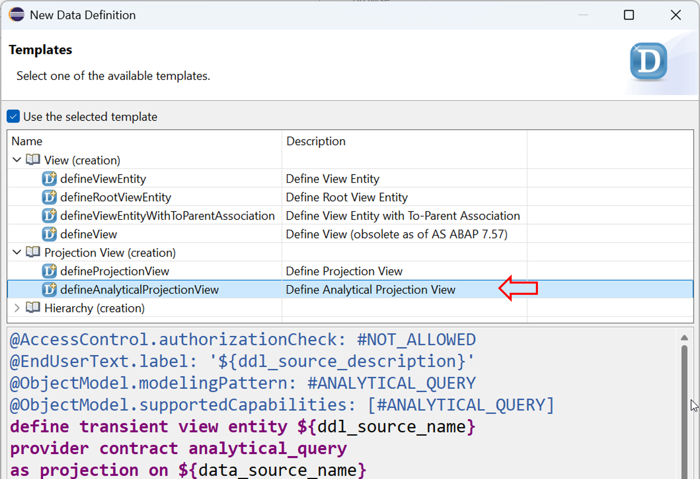
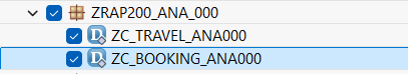
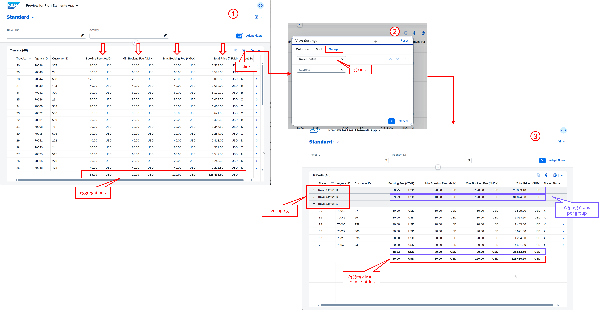
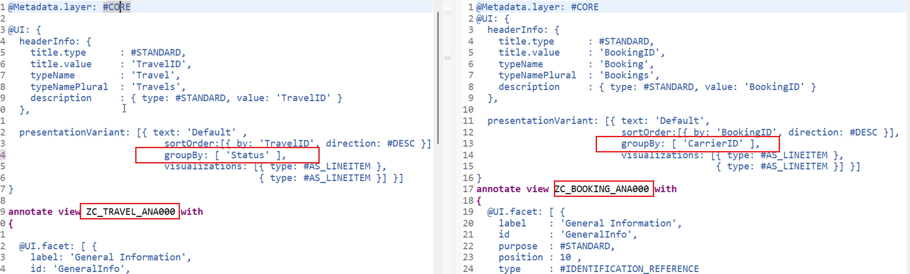

[Home - AD260](../../README.md)

# Exercise 6: Work with the Read-Only RAP Analytical Table

## Introduction

In the previous exercise, you've worked with the Background Processing Framework (bgPF) for asynchronous processing (_see [Exercise 5](../ex05/README.md)_) - or at least generated and published the _Travel_ processing app, as well as generated demo data (_see [Exercise 1](../ex01/README.md)_).

In this exercise, you will create a read-only _Travel_ app based on the read-only RAP Analytical Table. You will create a new sub-package, analytical CDS projection views, metadata extensions, a new service definition, and a service binding.


## Exercises

- [6.1 - Create a New Package](#exercise-61-create-a-new-package)
- [6.2 - Create the Analytical Data Model Projection](#exercise-62-create-the-analytical-data-model-projection)
- [6.3 - Define the UI Semantics](#exercise-63-define-the-ui-semantics)
- [6.4 - Create the Service Definition](#exercise-64-create-the-service-definition)
- [6.5 - Create and Publish the Service Binding](#exercise-65-create-and-publish-the-service-binding)
- [6.6 - Preview the New _Travel_ App](#exercise-66-preview-the-new-travel-app)
- [Summary](#summary)

<br/>

> [!TIP]
> <details>
>  <summary>Click to expand ADT tips!</summary>  
>  
> - Always replace all occurrences of the placeholder **`###`** in the provided code snippets with your personal suffix.
> - Use the ADT function _**Find and Replace All**_ (**Ctrl+F**) to quickly replace text in the source code.
> - Use the ADT function _**Quick Fix**_ (**Ctrl+1**), aka _Quick Assist_, on an erroneous element to get help with resolving the issue.
> - Use the **Show ABAP element info** view (**F2**) to inspect an element in ADT editors.
> - Use the **ABAP Formatter** function (**Ctrl+F1**) to format your source code.
> - [Useful Keyboard Shortcuts for ABAP Development](https://help.sap.com/docs/ABAP_PLATFORM_NEW/c238d694b825421f940829321ffa326a/4ec299d16e391014adc9fffe4e204223.html?version=latest) (ADT shortcuts)
>
> </details>

> [!NOTE]
> **About the RAP Analytical Table**
> 
> <details>
>  <summary>Click to expand!</summary>  
> 
>  <br/>
>  
> The RAP analytical table provides a type of data visualization on a SAP Fiori UI that contains a set of structured data and provides several possibilities for aggregating the data. It allows analytical evaluations in applications built with the ABAP RESTful Application Programming Model (RAP). The modeling is based on CDS views annotated with `@OData.applySupportedForAggregation: #FULL`.
> 
> **Only read-only RAP analytical tables** are supported at this time. SAP plans to support editable RAP analytical table in the future*. 
>  
> (*) This information reflects the current plans and may be changed by SAP without prior notice. Refer to the [ABAP Cloud Roadmap Information↗](https://help.sap.com/docs/abap-cross-product/roadmap-info/abap-cloud-roadmap-information) for updates.   
>  
> **Learn more:** [RAP Analytical Tables](https://help.sap.com/docs/abap-cloud/abap-rap/using-aggregate-data-in-sap-fiori-apps) | [Developing Read-only RAP Analytical Table](https://help.sap.com/docs/abap-cloud/abap-rap/developing-read-only-rap-analytical-tables)
>  </details>

---

## Exercise 6.1: Create a New Package

> Create a sub-package `ZRAP201_ANA_###` to group the analytical artefacts together.

<details>
  <summary>🔵 Click to expand!</summary>

1. In the **Project Explorer** in ADT, 
   - right-click on your exercise package **`ZRAP201_###`**, and
   - select **New** > **ABAP Package**, and
   - enter the following values:

     | Field | Value |
     |---|---|
     | Package Name | **`ZRAP201_ANA_###`** |
     | Description | **`Read-only RAP Analytical Table`** |
     | Superpackage | **`ZRAP201_###`** |

   Then, 
   - click **Next >**,
   - select a transport request if required, and
   - click **Next >**, then click **Finish** to confirm the creation.

<br/>

</details>

## Exercise 6.2: Create the Analytical Data Model Projection

> Create CDS projection views `ZC_TRAVELTP_ANA###` and `ZC_BOOKINGTP_ANA###` with analytical annotations for the Travel and Booking entities.

<details>
  <summary>🔵 Click to expand!</summary>

### Exercise 6.2.1: Create the analytical projection view for _Travel_ entity

> Create the **root** projection view `ZC_TRAVELTP_ANA###` with analytical annotations for the _Travel_ entity.
>  
> 💡**Booster** available below to speed up the implementation.

<details>
  <summary>🟣 Click to expand!</summary>

1. Now, 
   - right-click on the package **`ZRAP201_ANA_###`**, and
   - select **New** > **Other ABAP Repository Object** > **Core Data Services** > **Data Definition**,
   - Enter the following values:

     | Field | Value |
     |---|---|
     | Name              | **`ZC_TRAVELTP_ANA###`** |
     | Description       | **`Proj. view for Travel Analytical Table`** |
     | Referenced Object | **`ZR_TRAVELTP###`** |   
     | Package           | **`ZRAP201_ANA_###`** |
        
  Then, 
  - click **Next >** to continue,
  - select a transport request if requested,
  - click **Next >** to continue,
  - select the template **`defineProjectionView`** under **Projection View (creations)** in the tree, and
  - confirm with **Finish**.

   <!--  -->   

   > ---
   > 💡 **Booster:**
   > 
   > If you want to use this booster, please replace the entire source code of the data definition with the version provided in the document below
   > and then read the step-by-step instructions provided below to understand what has been done.
   >
   > Do not forget to replace all occurrences of the placeholder **`###`** with your personal suffix.
   >
   > 1. Replace the entire source code of the projection view **`ZC_TRAVELTP_ANA###`** with the version provided below:
   >   
   >    ▶🟡📄Source code document: [ex06_ddls_ZC_TRAVELTP_ANA###.txt](sources/ex06_ddls_ZC_TRAVELTP_ANA.txt)
   > 
   > 2. Save  (**Ctrl+S**). **Do not activate it yet.** You first need to create the analytical _Booking_ projection view **`ZC_BOOKINGTP_ANA###`** for the booking entity.
   > 
   > 3. Now, continue directly with **Exercise 6.2.2: Create the analytical projection view for _Booking_ entity**.
   > ---

   <br/>
   
2. Add key elements of the  _Travel_ projection view:

   - Specify the _Travel_ projection view as root entity by adding the keyword **`root`** after the keyword **`define`**   
     and add the provider contract **`transactional_query`** after the view name::

     ```abap
     define root view entity ZC_TRAVELTP_ANA### 
     provider contract transactional_query
     as projection on ZR_TRAVELTP###
     ```
     
   - Add the association **`_BaseEntity`** to the base _Travel_ view entity:

     ```abap
     association [1..1] to ZR_TRAVELTP### as _BaseEntity on $projection.UUID = _BaseEntity.UUID
     ```

   - Expose **`_BaseEntity`** at the end of the select list.

   - Redirect the **`_Booking`** association to the new analytical Booking projection view  **`ZC_BOOKINGTP_ANA###`**:

     ```abap
     _Booking : redirected to composition child ZC_BOOKINGTP_ANA###,
     ```
   - Add the view annotation **`@Metadata.allowExtensions: true`** in the header section, before the keyword **`define...`**, to allow the definition of metadata in a metadata extension:

     ```abap
     @Metadata.allowExtensions: true
     ```

3. Enable the RAP analytical table for the _Travel_ projection view.
     
   To achieve this, add the view annotation **`@OData.applySupportedForAggregation`** in the header section, before the keyword **`define...`**, to enable the RAP analytical table:

     ```abap
     @OData.applySupportedForAggregation: #FULL
     ```
   
4. Add the element annotation **`@Aggregation.default`** to define aggregated values as specify below.

     > ℹ️**Info**:  
     > 
     > | Annotation | Purpose |
     > |---|---|
     > | `@Aggregation.default: #AVG` | Show the average value |
     > | `@Aggregation.default: #MAX` | Show the maximum value |
     > | `@Aggregation.default: #MIN` | Show the minimum value |
     > | `@Aggregation.default: #SUM` | Show the sum of all values |

     - Add the annotation **`@Aggregation.default: #AVG`** to the **`BookingFee`** field to define the booking fee average and specify **`Booking Fee (#AVG)`** as the new column label:

       ```abap
       @Aggregation.default: #AVG
       @EndUserText.label: 'Booking Fee (#AVG)'
       @Semantics.amount.currencyCode: 'CurrencyCode'
       BookingFee,      
       ```

     - Add the **new** fields **`MinBookingFee`** to display the minimum booking fee (#MIN) and **`MaxBookingFee`** to display the maximum booking fee (#MAX) to the list:
         
       ```abap
       @Aggregation.default: #MIN
       @EndUserText.label: 'Min Booking Fee (#MIN)'
       @Semantics.amount.currencyCode: 'CurrencyCode' 
       BookingFee as MinBookingFee,
       
       @Aggregation.default: #MAX
       @EndUserText.label: 'Max Booking Fee (#MAX)'
       @Semantics.amount.currencyCode: 'CurrencyCode'
       BookingFee as MaxBookingFee,  
       ```

     -  Add the element annotation **`@Aggregation.default: #SUM`** to the **`TotalPrice`** field to define the summ of all total prices and specify **`Total Price (#SUM)`** as the new column label:

        ```abap
        @Aggregation.default: #SUM
        @EndUserText.label: 'Total Price (#SUM)'
        @Semantics.amount.currencyCode: 'CurrencyCode'
        TotalPrice,         
        ```         
   <br/>
  
5. Save  (**Ctrl+S**). **Do not activate yet**. 

   You first need to create the analytical Booking projection view **`ZC_BOOKINGTP_ANA###`** for the booking entity.

<br/>

</details>

  
### Exercise 6.2.2: Create the Analytical Projection View for _Booking_ Entity 

> Create the CDS projection view `ZC_BOOKINGTP_ANA###` with analytical annotations for the _Booking_ entity.
>  
> 💡**Booster** available below to speed up the implementation.

<details>
  <summary>🟣 Click to expand!</summary>
  
1. Create a new CDS projection view **`ZC_BOOKINGTP_ANA###`** in your exercise package **`ZRAP201_ANA_###`** 

   To achieve this, 
   - go to the **Project Explorer**,
   - right-click your base BO view **`ZR_BOOKINGTP###`**,
   - select **New Data Definition** from the context menu, and 
   - enter the requested information below:
  
     | Field | Value |
     |---|---|
     | Name              | **`ZC_BOOKINGTP_ANA###`** |
     | Description       | **`Proj. view for Booking Analytical Table`** |
     | Referenced Object | **`ZR_BOOKINGTP###`** |   
     | Package           | **`ZRAP201_ANA_###`** | 

   Then,     
   - click **Next >** to continue,
   - select a transport request if requested,
   - click **Next >** to continue,
   - select the template **`defineProjectionView`** under **Projection View (creations)** in the tree, and
   - confirm with **Finish**.

   > ---
   > 💡 **Booster:**
   > 
   > If you want to use this booster, please replace the entire source code of the data definition with the version provided in the document below
   > and then read the step-by-step instructions provided below to understand what has been done.
   >
   > Do not forget to replace all occurences of the placeholder **`###`** with your personal suffix.
   > 
   > 1. Replace the entire source code of the projection view **`ZC_BOOKINGTP_ANA###`** with the version provided here:
   >   
   >    ▶🟡📄Source code document: [ex06_ddls_ZC_BOOKINGTP_ANA###.txt](sources/ex06_ddls_ZC_BOOKINGTP_ANA.txt)
   >   
   > 2. Save  the changes and activate both projection views together at the same time by pressing **Ctrl+Shift+F3**.
   >  
   >        
   > 
   > 4. Now, continue directly with [**Exercise 6.3: Create the Metadata Extensions**](#exercise-63-create-the-metadata-extensions).
   >    
   > ---   

   <br/>
   
2. Add key elements of the analytical _Booking_ projection view:

   <!-- > ℹ️ Note that the complete source code of `ZC_BOOKINGTP_ANA###` is provided below. -->

   - Add the association **`_BaseEntity`** to the base _Booking_ view entity:

     ```abap
     association [1..1] to ZR_BOOKINGTP### as _BaseEntity on $projection.UUID = _BaseEntity.UUID
     ```

   - Expose **`_BaseEntity`** at the end of the select list.

   - Redirect the **`_Travel`** association to the new analytical Travel projection view **`ZC_TRAVELTP_ANA###`**:

     ```abap
     _Booking : redirected to composition child ZC_BOOKINGTP_ANA###,
    - Add the view annotation **`@Metadata.allowExtensions: true`** in the header section, before the keyword **`define...`**, to allow the definition of metadata in a metadata extension:
      ```abap
      @Metadata.allowExtensions: true
      ```

3. Enable the RAP analytical table for the _Booking_ projection view:

   - Add the view annotation **`@OData.applySupportedForAggregation`** in the header section , before the keyword **`define...`**, to enable the RAP analytical table:

     ```abap
     @OData.applySupportedForAggregation: #FULL
     ```

     - Add the annotation **`@Aggregation.default: #SUM`** to the **`FlightPrice`** field to computation of the sum of all flight prices and specify **`Flight Price (#SUM)`** as the new column label:

       ```abap
       @Aggregation.default: #SUM
       @EndUserText.label: 'Flight Price (#SUM)'
       @Semantics: { amount.currencyCode: 'CurrencyCode' }
       FlightPrice,     
       ```

       - Add the **new** fields **`AvgFlightPrice`** to display the average of the flight prices (#AVG) and **`MinFlightPrice`** to display the minimum flight price (#MIN) to the `select` list:
         
         ```abap
         @Aggregation.default: #AVG
         @EndUserText.label: 'Flight Price (#AVG)'
         @Semantics: { amount.currencyCode: 'CurrencyCode' }
         FlightPrice as AvgFlightPrice, 
              
         @Aggregation.default: #MIN
         @EndUserText.label: 'Flight Price (#MIN)'
         @Semantics: { amount.currencyCode: 'CurrencyCode' } 
         FlightPrice as MinFlightPrice,     
         ```      

4. Now, save  the changes and activate both projection views together at the same time by pressing **Ctrl+F9**.

<br/>

</details>

</details>

## Exercise 6.3: Define the UI Semantics

> Define the UI semantics for the analytical projections by creating the CDS metadata extensions `ZC_TRAVELTP_ANA###` and `ZC_BOOKINGTP_ANA###` for the _Travel_ and _Booking_ projection views respectively.

<details>
  <summary>🔵 Click to expand!</summary>

1. Create the metadata extension **`ZC_TRAVELTP_ANA###`** for the projection view **`ZC_TRAVELTP_ANA###`** in your exercise package **`ZRAP201_ANA_###`**.

   To achieve this, 
   - go to the **Project Explorer**,
   - right-click your BO view projection **`ZC_TRAVELTP_ANA###`** ,
   - select **New Metadata Extension** from the context menu, and 
   - enter the requested information below:
     
     | Field | Value|
     |---|---|
     | Name             | **`ZC_TRAVELTP_ANA###`** |
     | Description      | **`UI annotations for ZC_TRAVELTP_ANA###`** |
     | Extended Entity  | **`ZC_TRAVELTP_ANA###`** |   
     | Package          | **`ZRAP201_ANA_###`** |  

   Then,   
   - click **Next >** to continue,
   - select a transport request if requested, and 
   - confirm with **Finish**.   

2. Replace the entire source code of each metadata extension with the appropriate new version provided below, and replace all occurrences of the placeholder **`###`** with your personal suffix.

   ▶🟡📄**Source Code document:** [**ex06_ddlx_ZC_TRAVELTP_ANA###.txt**](sources/ex06_ddlx_ZC_TRAVELTP_ANA.txt)      
   
3. Save  (**Ctrl+S**) and activate  (**Ctrl+F3**) the changes.

4. Now, create the metadata extension **`ZC_BOOKINGTP_ANA###`** for the projection view **`ZC_BOOKINGTP_ANA###`** in your exercise package **`ZRAP201_ANA_###`**.

5. Enter following values:

   | Field | Value  | 
   |---|---|
   | Name             | **`ZC_BOOKINGTP_ANA###`** |
   | Description      | **`UI annotations for ZC_BOOKINGTP_ANA###`** |
   | Extended Entity  | **`ZC_BOOKINGTP_ANA###`**  |   
   | Package          | **`ZRAP201_ANA_###`** |  

6. Replace the entire source code of each metadata extension with the appropriate new version provided below and replace all occurrences of the placeholder **`###`** with your personal suffix.

   ▶🟡📄**Source Code document:** [**ex06_ddlx_ZC_BOOKINGTP_ANA###.txt**](sources/ex06_ddlx_ZC_BOOKINGTP_ANA.txt)
   
7. Save  (**Ctrl+S**) and activate  (**Ctrl+F3**) the changes.

<br/>

</details>


## Exercise 6.4: Create the Service Definition

> Create the service definition `ZUI_TRAVELTP_ANA_O4###` to expose the analytical projections.

<details>
  <summary>🔵 Click to expand!</summary>

1. Right-click on the CDS projection view **`ZC_TRAVELTP_ANA###`** and select **New Service Definition** from the context menu.

2. Enter the following values:

   | Field | Value |
   |---|---|
   | Name               | **`ZUI_TRAVELTP_ANA_O4###`** |
   | Description        | **`Service Def for ZC_TRAVELTP_ANA###`** |
   | Referenced Object  | **`ZC_TRAVELTP_ANA###`**  |   
   | Package            | **`ZRAP201_ANA_###`** |     

3. Perform followings adjustments:

   - Specify **`ZC_TRAVELTP_ANA###`** as the lead entity in the header section using the view annotation **`@ObjectModel.leadingEntity.name`**:

     ```abap
     @ObjectModel.leadingEntity.name: 'ZC_TRAVELTP_ANA###'  
     ```     
     
   - Add **`Travel`** as alias for the analytical _Travel_ projection view **`ZC_TRAVELTP_ANA###`**:

     ```abap
     expose ZC_TRAVELTP_ANA### as Travel;
     ```
     
   - Also expose the analytical _Booking_ projection view **`ZC_BOOKINGTP_ANA###`** with the alias **`Booking`**:

     ```abap
     expose ZC_BOOKINGTP_ANA### as Booking;
     ```

4. ℹ️The entire source code should look as follows:
  
   ```abap
   @EndUserText.label: 'Service Def for ZC_TRAVELTP_ANA###'
   @ObjectModel.leadingEntity.name: 'ZC_TRAVELTP_ANA###' 
   define service ZUI_TRAVELTP_ANA_O4### {
     expose ZC_TRAVELTP_ANA###  as Travel;
     expose ZC_BOOKINGTP_ANA### as Booking;
   }
   ```       

5. Save  (**Ctrl+S**) and activate  (**Ctrl+F3**) the changes.

</details>

## Exercise 6.5: Create and Publish the Service Binding

> Create the service binding `ZUI_TRAVELTP_ANA_O4###`, publish it, and preview the analytical Travel app.

<details>
  <summary>🔵 Click to expand!</summary>

1. Right-click on the service definition **`ZUI_TRAVELTP_ANA_O4###`** and select **New Service Binding** from the context menu.

2. Enter the following values:

   | Field | Value |
   |---|---|
   | Name               | **`ZUI_TRAVELTP_ANA_O4###`** |
   | Description        | **`Service Binding for ZC_TRAVELTP_ANA###`** |
   | Binding Type       | **`OData V4 - UI`** |
   | Service Definition | **`ZUI_TRAVELTP_ANA_O4###`**  |   
   | Package            | `ZRAP201_ANA_###` |        

4. Click **Next**, select a transport request, and confirm the dialog to create the new service binding.

5. Save  (**Ctrl+S**) and activate  (**Ctrl+F3**) the new service binding.

6. Click the **Publish** button to publish the local service endpoint.

   <!--    -->

</details>

## Exercise 6.6: Preview the New _Travel_ App

> Preview the _Travel_ app and play around.

<details>
  <summary>🔵 Click to expand!</summary>

1. Go to the **Service Binding**, select the **Travel** entity (leading entity) and start the **SAP Fiori Elements App Preview**.

2. Press **Go** to load the data in the app.

3. Verify that:
   - The analytical table displays Travel data with aggregated values.
   - You can group, filter, and sort the data in the analytical table via , the **Settings** icon:
     - Group the _travel_ records by the travel status field **`Status`** --> **Group By Travel Status**
     - Group the _booking_ records by the carrier ID field **`CarrierId`** --> **Group By `Airline ID`** 
        
   <br/>
   
       

<br/>

> 💡**Hint**: The default grouping can be defined in the backend using CDS annotations

4. Go to ADT and adjust the corresponding metadata extensions.

   - In the metadata extension **`ZC_TRAVELTP_ANA###`**, add or uncomment the line **`groupBy: [ 'Status' ],`** in the header section as displayed on the screenshot to define the default grouping for the _Travel_ data in the _travel_ list report table.
   
   -  In the metadata extension **`ZC_BOOKINGTP_ANA###`**,  add or uncomment the line **`groupBy: [ 'CarrierID' ],`** in the header section as displayed on the screenshot to define the default grouping of the _Booking_ data in the _booking_ table on the object page.
      
      <br/>
   
          

</details>


## Summary
[^Top of page](#introduction)

Congratulations! 🎉 You have successfully completed all exercises of the AD260 (aka RAP201) workshop.

You've...
- created a new sub-package for the new _Travel_ app with analytical capabilities,
- created analytical CDS projection views for Travel and Booking with aggregation annotations,
- defined metadata extensions for the analytical UI layout,
- created a service definition and service binding, and
- published and previewed the read-only RAP analytical table.

Throughout this workshop, you have built a complete Travel Processing application using RAP, covering:
- ✅ Transactional UI service generation with the RAP Generator
- ✅ Business logic with determinations, actions, and feature control
- ✅ Collaborative draft handling
- ✅ Event-driven side effects
- ✅ Read-only RAP Analytical Tables

▶ Return to **[Home - AD260](../../README.md)**

---
